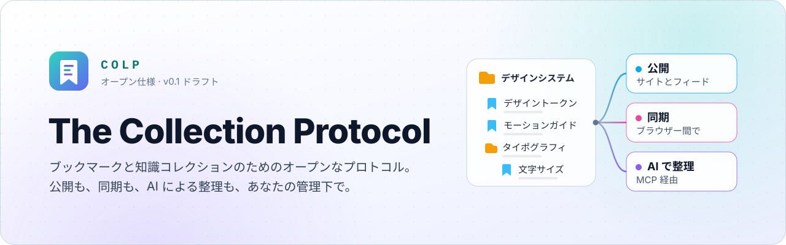
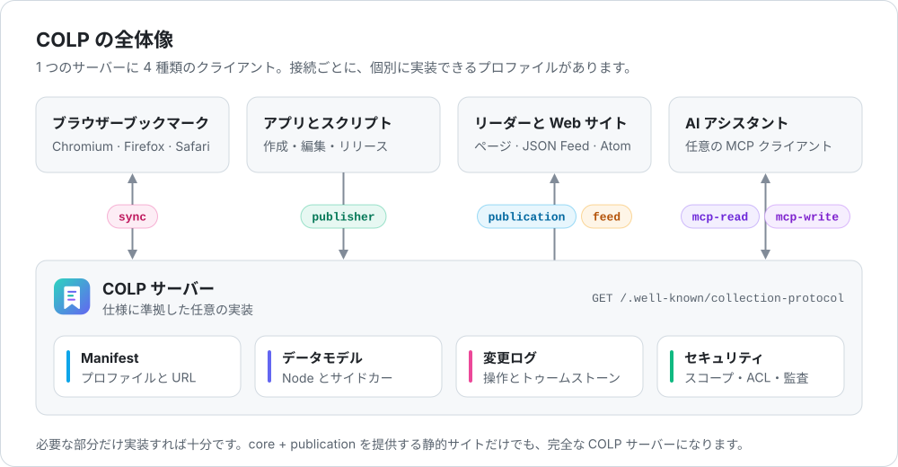
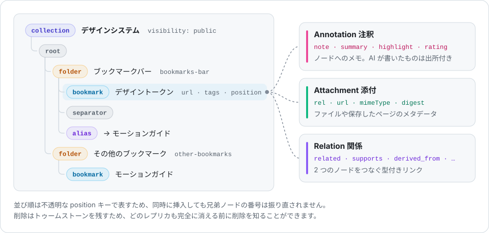
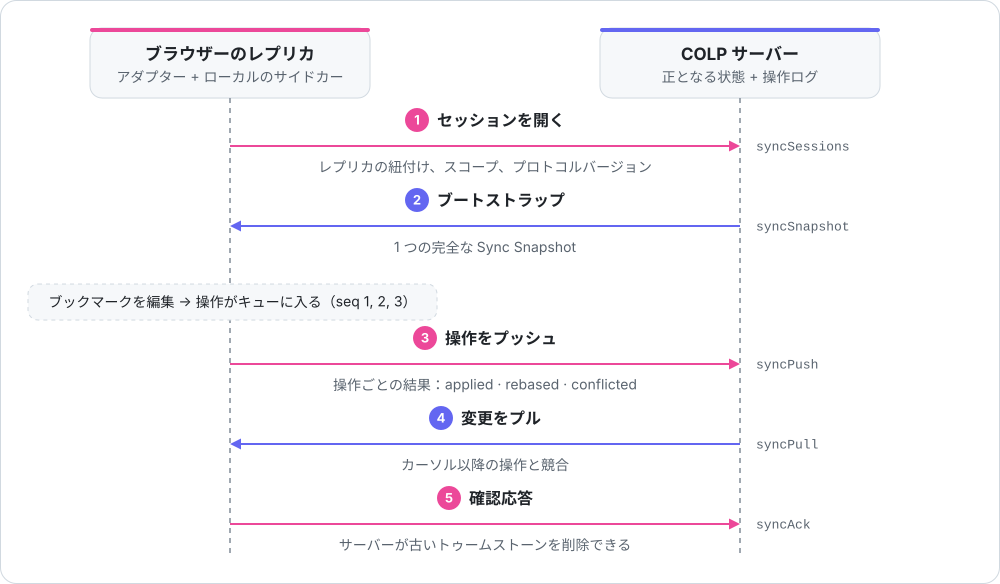
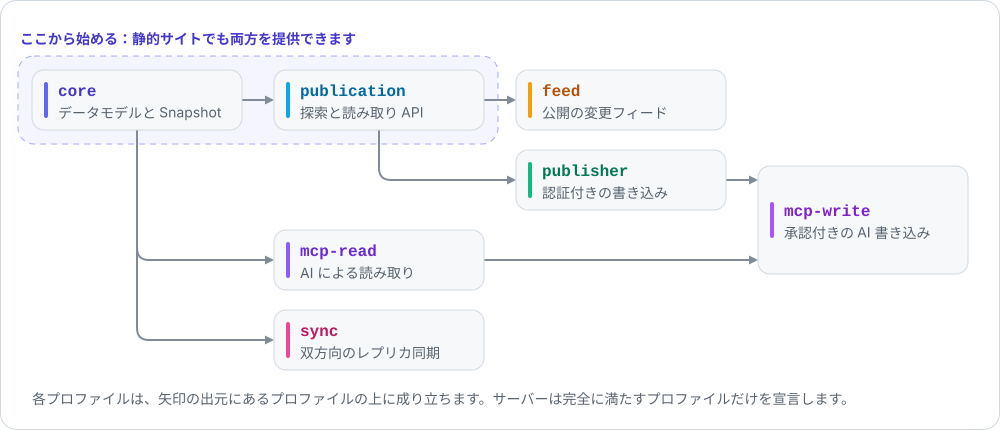

<h1 align="center">
  <picture>
    <source media="(prefers-color-scheme: dark)" srcset="docs/assets/banner.ja.dark.svg">
    
  </picture>
</h1>

<p align="center"><b>ブックマークを自分のサーバーに。どのブラウザーからも使えて、AI に整理を任せても安心です。</b></p>

<p align="center">
  <a href="deploy/INSTALL.md"><b>インストールガイド</b></a> ·
  <a href="https://github.com/WhitenWhiten/colp/releases">リリース</a> ·
  <a href="protocol/SPECIFICATION.md">仕様</a>
</p>

<p align="center"><sub><a href="README.md">English</a> · <a href="README.zh-CN.md">简体中文</a> · <b>日本語</b></sub></p>

<p align="center">
  <a href="https://github.com/WhitenWhiten/colp/actions/workflows/colp-ci.yml"></a>
  <a href="protocol/SPECIFICATION.md"></a>
  <a href="protocol/docs/05-mcp-profile.md"></a>
  <a href="packages/node"></a>
  <a href="LICENSE"></a>
</p>

**COLP** は、あなたのブックマークを、自分で運用するサーバー上の 1 つのライブラリにまとめます。ブラウザー拡張機能 **Know-N** が、使っているすべてのブラウザーとこのライブラリを同期し、新しく保存したページはルールが適切なフォルダーに振り分けます。AI エージェントは MCP を通じてライブラリを読み、整理し直すことができますが、何を変更するかはあなたが承認します。その土台にあるのが **Collection Protocol** です。ブックマークとキュレーションされたコレクションのための、HTTP ネイティブなオープンプロトコルで、リファレンス実装を npm で公開しています。

<p align="center">
  
  <br><sub>COLP Server の Web アプリに表示したライブラリと、ルールが論文を Academic に振り分けた直後の Know-N ポップアップ。<code>node scripts/capture-readme.mjs</code> で合成データから描画しています。</sub>
</p>

> 拡張機能と Web アプリの画面は英語のみです。このページでは画面上の名称を英語のまま太字で示します。リンク先のドキュメント（インストールガイド、各パッケージの README、仕様本文など）の多くも英語で、仕様は英語版が正です。

## COLP の特長

- **自分のライブラリを、自分のサーバーに。** アカウントごとに非公開のライブラリが 1 つあり、自分が管理するマシンの PostgreSQL に保存されます。ブックマークは普通のブラウザーのブックマークのままで、データはいつでもすべて持ち出せます。
- **どのブラウザーでも、同じ 1 つのツリー。** 拡張機能は、各ブラウザーのブックマークバーとその他のブックマークを同じライブラリにまとめ、双方向に同期し続けます。保存はオフラインでもアカウントなしでもでき、同期はあとから追いつきます。
- **ルールが保存先を決めます。** ブラウザー内のルールは、オフラインでもアカウントなしでも動きます。サーバー側のルールは、保存したページにタグを付けたり要約したりもできます。
- **AI はまず確認を求めます。** Claude Code や Codex などのエージェントは MCP で接続します。ブックマークの追加はすぐに反映されますが、移動や削除はあなたの承認を待つ計画になります。コミットした計画は、どれも元に戻せます。
- **共有するのはフォルダーだけ。** 限定公開（unlisted）の読み取り専用リンクで、1 つのフォルダーの最新の内容を、共有を止めるまで見せられます。ライブラリそのものは常に非公開のままです。
- **オープンなプロトコル。** バージョン付きの仕様、JSON Schema、実行可能な例、適合性テストランナーがそろっているので、ほかのサーバーやクライアントも参加できます。

## ブックマークライブラリを立ち上げる

1. **COLP Server を起動します。** 自分のマシンか小さな VPS で、Docker Compose を使って動かします。HTTPS、最初のオーナーアカウント、バックアップ、アップグレードについては [インストールガイド](deploy/INSTALL.md) で説明しています。
2. **Know-N 拡張機能をインストールします。** Chrome またはほかの Chromium 系ブラウザー向けのものを [リリースページ](https://github.com/WhitenWhiten/colp/releases) から入手し、**Account** → **Server** にサーバーのアドレスを入力してサインインします（[詳細](deploy/INSTALL.md#5-connect-a-browser)）。
3. **最初の同期を確認します。** 初期設定ではすべてのフォルダーが同期されます。このブラウザーだけに残したいフォルダーは、チェックを外してください。ブラウザーごとに同じ手順を繰り返すと、1 分以内にどのブラウザーも同じ内容にそろいます。

以降は、Web アプリの **Library**（ライブラリ）にブラウザーと同じツリーが表示されます。各部分の働きは以下で説明しています。すぐに [エージェントを接続する](deploy/INSTALL.md#6-connect-an-agent) こともできます。

## どのブラウザーでも同じライブラリ

<p align="center">
  
  <br><sub>Research フォルダーを開いた Web アプリの Library。</sub>
</p>

各アカウントには非公開の **Bookmarks** ライブラリが 1 つあり、最初から **Bookmarks bar**（ブックマークバー）と **Other bookmarks**（その他のブックマーク）が用意されています。あとから作ったフォルダーも同期されます。新しいフォルダー、インポートしたブックマーク、保存したページは選んだ場所に入り、Other bookmarks に自動で入ることはありません。**Sync center**（同期センター）には、接続中のブラウザー、競合、ゴミ箱が並びます。**Version history**（バージョン履歴）はライブラリ全体を以前の状態に戻し、**Link health**（リンクの状態）はリンク切れ、リダイレクト、重複を見つけ、**Import**（インポート）はどのブラウザーやブックマークツールのブックマークファイルでも取り込みます。

## ブラウザーで保存・整理する

<p align="center">
  
  <br><sub>ブラウザー本来のブックマークを扱う Know-N のブックマークマネージャー。</sub>
</p>

**Alt+S** を押すか、右クリックメニューを使って保存します。ページのメニューからは今見ているページを、リンクのメニューからはリンク先を保存でき、保存するときにフォルダーを選び、タグとメモを付けられます。Know-N はブラウザー本来のブックマークを管理するので、拡張機能がなくてもブックマークはそのまま使えます。ここで紹介した機能は、すべてアカウントなしで動きます。COLP Server にサインインすると、同期が加わります。機能の一覧と、拡張機能が求めるすべての権限は [拡張機能の README](packages/extension/README.md) にあります。

## 保存したページをルールで振り分ける

<p align="center">
  
  <br><sub>ブラウザー内のルール。オフラインでも、最初に一致したルールが行き先を決めます。</sub>
</p>

ルールは「arxiv.org の論文は Research へ」のような決まりです。行き先を決める順番は常に同じで、自分で選んだフォルダーが最優先です。次にアカウントのルール、その次にこのブラウザーのルール、設定していれば AI の提案と続き、どれにも当てはまらなければ、ページは保存した場所にそのまま残ります。保存する前にページをルールで試したり、すでにあるブックマークにルールを一度だけ実行したり、その実行を取り消したりもできます。サーバー側のルールはタグ付けと要約もできます。ルールが書いたダイジェストや要約は **Automations**（オートメーション）→ **Digests**（ダイジェスト）にまとまり、新しいものは **Activity**（アクティビティ）の受信箱に届きます。

## AI エージェントと、あなたの承認

<p align="center">
  
  <br><sub>Approvals ページで承認を待つエージェントの計画。</sub>
</p>

Claude Code、Codex、ChatGPT などの MCP クライアントは、OAuth で `/collections/-/mcp-compat` に接続します。スクリプトには API キーを渡すこともできます。どのエージェントも最初は **Manual**（手動）モードです。ブックマークの追加はすぐに反映され、移動と削除は **Approvals**（承認）ページで承認を待つ計画になります。**Trusted**（信頼済み）に切り替えたエージェントの移動は直接適用されますが、その場合も元に戻せます。削除、ゴミ箱を空にする操作、完全削除（purge）は、常にあなたの承認を待ちます。**Activity** の受信箱には、エージェントが追加したものと、あなたの対応を待っているものが表示されます。

エージェントを接続したら、まずは次のようなプロンプトで試してみてください。

> colp MCP サーバーを使って私のブックマークライブラリを見つけ、「Read later」フォルダーの中身を読んでください。各ブックマークを「Bookmarks bar」の下の適切なフォルダーに振り分ける計画を提案してください。新しく作るフォルダーは 3 つまでにしてください。何も削除しないでください。振り分けられなかったものがあれば教えてください。

## フォルダーを共有する

<p align="center">
  
  <br><sub>サインインしていない訪問者が、限定公開リンクで見た共有フォルダー。</sub>
</p>

フォルダーで **Share…**（共有）を選ぶと、サブフォルダーを含む最新の内容を見せる、限定公開の読み取り専用リンクが作られます。**Stop sharing**（共有を停止）を選ぶと、リンクはすぐに無効になります。共有リンクがディレクトリ、フィード、検索インデックスに載ることはなく、フォルダー内の非公開の項目は表示されません。

拡張機能は、対応している Web サイトのお気に入りもブックマークにできます。**Site adapters**（サイトアダプター）ページでは、Bilibili のお気に入りを選んだフォルダーに保存し、お気に入りリストごとにサブフォルダーを作って最新の状態に保ちます。

## プロトコルの仕組み

ここでは要点だけを紹介します。[5 分でわかる COLP](protocol/README.ja.md#5-分でわかる-colp) ではもう一段詳しく説明し、[用語集（英語）](protocol/GLOSSARY.md) ではすべての用語を解説しています。

<p align="center">
  <picture>
    <source media="(prefers-color-scheme: dark)" srcset="docs/assets/architecture.ja.dark.svg">
    
  </picture>
</p>

### データモデル

<p align="center">
  <picture>
    <source media="(prefers-color-scheme: dark)" srcset="docs/assets/data-model.ja.dark.svg">
    
  </picture>
</p>

**Collection** は **Node**（`root`、`folder`、`bookmark`、`separator`、`alias`）の順序付きツリーで、ブラウザーのブックマークツリーと 1 対 1 に対応します。ブラウザーが保存できないデータは、ツリーの横に **サイドカー** として置きます。注釈（メモ、要約、ハイライト、評価。AI が書いたものには出所情報が付きます）、添付、型付きの関係です。それ以外のデータは名前空間付きの `extensions` に入れ、サーバーはそのまま保持します。詳しくは [01 コアデータモデル](protocol/docs/01-core-data-model.md) を参照してください。

### 双方向同期

<p align="center">
  <picture>
    <source media="(prefers-color-scheme: dark)" srcset="docs/assets/sync-flow.ja.dark.svg">
    
  </picture>
</p>

レプリカ同士がやり取りするのはツリー全体ではなく **操作** です。各操作にはレプリカごとの連番と、作成時に基づいていたリビジョンが付くため、サーバーはそれを適用するか、リベースするか、競合として記録できます。再送されたプッシュが二重に適用されることもありません。削除はトゥームストーンを残し、アクティブなレプリカがすべて確認応答するまで保持されます。詳しくは [03 同期](protocol/docs/03-sync.md) と [06 ブラウザーマッピング](protocol/docs/06-browser-mapping.md) を参照してください。

### プロファイル

<p align="center">
  <picture>
    <source media="(prefers-color-scheme: dark)" srcset="docs/assets/profiles.ja.dark.svg">
    
  </picture>
</p>

COLP は組み合わせ可能な適合プロファイルに分かれています。サーバーは完全に満たすプロファイルだけを Manifest で宣言し、クライアントはそれ以外のすべてを Manifest から見つけます。

| プロファイル | 追加されるもの | 仕様 |
|---|---|---|
| `core` | オブジェクト、厳格な JSON Schema、セマンティック検証、完全な Snapshot | [01](protocol/docs/01-core-data-model.md) |
| `publication` | ディスカバリー、ディレクトリ、メタデータ、ページ分割された Snapshot、ETag、Problem Details | [02](protocol/docs/02-http-publication-feed.md) |
| `feed` | カーソル付きの公開変更ストリーム、JSON Feed、Atom | [02](protocol/docs/02-http-publication-feed.md) |
| `publisher` | `If-Match`、冪等キー、リリースを備えた認証付きの書き込み | [08](protocol/docs/08-write-api.md) |
| `sync` | セッション、プッシュ、プル、確認応答、競合、トゥームストーン | [03](protocol/docs/03-sync.md) |
| `mcp-read` | MCP のリソースと読み取り専用ツール | [05](protocol/docs/05-mcp-profile.md) |
| `mcp-write` | MCP の書き込みツール、スコープ、監査、リスクの高い変更のための計画 / コミット | [05](protocol/docs/05-mcp-profile.md) |

## プロトコルを使って開発する

### npm からインストール

**Node.js 22 以降**が必要です。アプリケーションにリファレンス実装をインストールします。

```bash
npm install @know-n/colp@0.3.0
```

TypeScript の型定義が含まれ、ESM と CommonJS の両方に対応しています。次の例を `colp-demo.mjs` として保存すると、サーバーなしでパッケージを試せます。

```js
import { protocolVersion, supportedProfiles } from '@know-n/colp';
import { createUrlHash } from '@know-n/colp/semantic';

console.log(protocolVersion); // '0.1'
console.log(supportedProfiles); // core, publication, publisher, feed, sync, mcp-read, mcp-write
console.log(createUrlHash('https://example.com/'));
```

```bash
node colp-demo.mjs
```

API は `@know-n/colp/client`、`@know-n/colp/server`、`@know-n/colp/semantic` などのサブパスからインポートします。パッケージのルートはプロトコルのメタデータを提供します。検証、HTTP 公開、同期、MCP の例は [パッケージ README](packages/node/README.md) と [API ガイド](packages/node/docs/API.md) を参照してください。`0.x` の API はマイナーバージョン間で変わる可能性があるため、組み込むときはバージョンを固定してください。

### ざっと見てみる

すべては well-known URL から始まります。Manifest は、サーバーが対応するプロファイルと各エンドポイントの場所をクライアントに伝えるので、クライアントがパスを推測することはありません。

```http
GET /.well-known/collection-protocol HTTP/1.1
Host: alice.example
Accept: application/vnd.collection-protocol.manifest+json
```

```jsonc
{
  "protocol": "https://know-n.com/colp/spec/0.1",
  "protocolVersions": ["0.1"],
  "serverUuid": "019b3c67-a03c-7f02-9c7e-1ee8d50a77de",
  "title": "Alice's Collections",
  "mounts": [{
    "id": "default",
    "baseUrl": "https://alice.example/collections/",
    "profiles": ["core", "publication", "publisher", "sync", "mcp-read", "mcp-write"],
    "endpoints": {
      "directory": "https://alice.example/collections",
      "collection": "https://alice.example/collections/c/{collectionId}",
      "snapshot": "https://alice.example/collections/c/{collectionId}/snapshot",
      "mcp": "https://alice.example/collections/-/mcp"
      // ... every endpoint the declared profiles require
    }
  }]
}
```

Node.js のリファレンス実装を使うと、クライアントは Manifest をたどり、検証済みの完全な Snapshot を組み立てます。

```ts
import { ColpClient } from '@know-n/colp/client';

const client = new ColpClient({
  manifestUrl: 'https://alice.example/.well-known/collection-protocol',
});

const manifest = await client.discover();
const snapshot = await client.getSnapshot('interface-systems');
console.log(manifest.title, snapshot.nodes.length);
```

完全な例は [`protocol/examples/public-manifest.json`](protocol/examples/public-manifest.json) にあります。28 個の例はすべて CI で検証しています。

### クローンして試す

リポジトリをクローンしたら、リファレンスパッケージをビルドし、サンプルサーバーのセルフテストを実行します。セルフテストは小さな `core + publication` サーバーを起動し、`ColpClient` で Manifest からすべてを読み戻してから終了します。

```bash
git clone https://github.com/WhitenWhiten/colp.git && cd colp
npm run install:package && npm run build
npm run example:publication -- --self-test
```

```text
Manifest:  Example Collections (core, publication)
Directory: 1 collection(s)
Metadata:  Interface Systems
Snapshot:  2 node(s), 1 annotation(s)
```

`curl` で触ってみたい場合は、`--self-test` を付けずに起動し、終わったら Ctrl+C で止めてください。

```bash
npm run example:publication
curl -i http://127.0.0.1:8080/.well-known/collection-protocol
```

このサーバーは `node:http` で作った [1 つのファイル](packages/node/examples/publication-server.mjs) だけでできています。どこがアプリケーションの担当で、どこをパッケージが引き受けるのかがわかります。

### サーバーを検査する

稼働中の COLP サーバーが仕様に適合しているかどうかは、このリポジトリをクローンしなくても確かめられます。

```bash
npx --yes --package=@know-n/colp-conformance@0.1.1 colp-conformance https://your-server.example
```

URL を自分のサーバーのオリジンまたは Manifest URL に置き換えてください。オプションとプログラムからの使い方は [ランナー README](packages/conformance/README.md) にあります。どちらのパッケージも npm で公開しています。[@know-n/colp](https://www.npmjs.com/package/@know-n/colp) と [@know-n/colp-conformance](https://www.npmjs.com/package/@know-n/colp-conformance) です。

## 目的別ガイド

| やりたいこと | 最初に読むもの |
|---|---|
| 自分のブックマークサーバーを運用する | [インストールガイド](deploy/INSTALL.md)、次に [COLP Server の README](packages/server/README.md) |
| ブラウザー拡張機能を使う | [Know-N の README](packages/extension/README.md) |
| AI エージェントを接続する | インストールガイドの「[Connect an agent](deploy/INSTALL.md#6-connect-an-agent)」 |
| プロトコルの仕組みを理解する | [5 分でわかる COLP](protocol/README.ja.md#5-分でわかる-colp)、次に [用語集（英語）](protocol/GLOSSARY.md) |
| TypeScript や JavaScript で COLP のデータを読む・検証する | [パッケージの README](packages/node/README.md) と [API ガイド](packages/node/docs/API.md) |
| 自分のサーバーで COLP を提供する | [Publication クイックスタート](packages/node/docs/PUBLICATION_QUICKSTART.md) と [サンプルサーバー](packages/node/examples/publication-server.mjs) |
| 別の言語で COLP を実装する | プロトコル README の [どこから読むか](protocol/README.ja.md#どこから読むか) |
| コントリビュートする | [CONTRIBUTING.md](CONTRIBUTING.md) |

## リポジトリ構成

| パス | 内容 |
|---|---|
| [`protocol/`](protocol/README.ja.md) | 仕様、用語集、JSON Schema、実行可能な例、要件レジストリ |
| [`packages/node/`](packages/node/README.md) | `@know-n/colp`：TypeScript によるリファレンス実装と、そのテストと [ガイド](packages/node/docs/README.md) |
| [`packages/conformance/`](packages/conformance/README.md) | `colp-conformance`：任意の COLP サーバーに使えるブラックボックステストランナー |
| [`packages/server/`](packages/server/README.md) | COLP Server：PostgreSQL ストレージ、アカウントのライブラリ、同期、オートメーション、エージェント向けの MCP、フォルダーの共有リンク |
| [`packages/web/`](packages/web/README.md) | COLP Server が配信する Web アプリ |
| [`packages/extension/`](packages/extension/README.md) | Know-N：COLP Server と同期する、Chromium 系ブラウザー向けの Manifest V3 ブックマークマネージャー |
| [`deploy/`](deploy/INSTALL.md) | セルフホスト構成のインストールと運用 |
| [`docs/`](docs) | 設計メモとエビデンス。たとえば [オートメーションのバックエンド](docs/automation/README.md)。[`docs/assets/`](docs/assets) には README の画像があります |
| [`.github/workflows/colp-ci.yml`](.github/workflows/colp-ci.yml) | CI：プロトコルのチェック、例の検証、型チェック、テスト、エビデンスのチェック |

よく使うコマンド（リポジトリのルートで実行）：

```bash
npm test                                   # the package's test suite
npm run check                              # every gate CI runs for the package
npm run conformance -- <server-url>        # test a live server (run `npm --prefix packages/conformance ci` once first)
node scripts/check-readmes.mjs             # the READMEs agree with each other and the packages
node scripts/capture-readme.mjs            # re-render the README screenshots (needs ffmpeg and xvfb)
cd protocol && python scripts/validate_examples.py   # validate the protocol examples (Python 3, see protocol/README.md)
```

## プロジェクトの状況

| 構成要素 | バージョン | 状態 |
|---|---|---|
| 仕様 | `0.1-draft` | 0.1 のワイヤー契約は確定しており、すべての DTO に安定した `$defs` 名があります。0.2 の追加分（Sync のサーバーを正とするプルの効果、authoritative pull effects）には、専用のスキーマと要件レジストリがあります。 |
| `@know-n/colp` | 0.3.0 | 7 つのプロファイルをすべて実装しています。MUST と MUST NOT の要件はすべてテストに対応付けられ、[TRACEABILITY.md](packages/node/docs/TRACEABILITY.md) に一覧があります。 |
| `@know-n/colp-conformance` | 0.1.1 | 匿名での `core + publication` の読み取りに対応しています。認証付きの読み取りとほかのプロファイルは、次に対応する予定です。 |
| COLP Server | 0.1.0 のリリース候補 | ライブラリ、同期、共有、オートメーション、エージェントと承認。コンテナーイメージを GitHub で公開しています。[変更履歴](packages/server/CHANGELOG.md) を参照してください。 |
| Know-N 拡張機能 | 0.1.0 のリリース候補 | 安定版が Chrome ウェブストアに公開されるまでは、GitHub のリリースから入手し、パッケージ化されていない拡張機能として読み込みます。[変更履歴](packages/extension/CHANGELOG.md) を参照してください。 |

## コントリビューション

Issue と Pull Request を歓迎します。質問や初期段階のアイデアは [Discussions](https://github.com/WhitenWhiten/colp/discussions) へどうぞ。まず [CONTRIBUTING.md](CONTRIBUTING.md) をお読みください。プロトコルを変更するときは、仕様、スキーマ、例、要件レジストリをまとめて更新し、README を変更するときは 3 つの言語すべてを更新してください。[GOVERNANCE.md](GOVERNANCE.md) には変更の決め方を、[ROADMAP.md](ROADMAP.md) には今後の予定をまとめています。脆弱性は [SECURITY.md](SECURITY.md) に従って非公開で報告してください。参加するすべての人に [行動規範](CODE_OF_CONDUCT.md) を守っていただくようお願いしています。

## ライセンス

[Apache License 2.0](LICENSE)。ブラウザー拡張機能が使う Know-N の名称、ロゴ、ワードマークはこのライセンスの対象外です。詳しくは拡張機能の [README](packages/extension/README.md#license) を参照してください。
