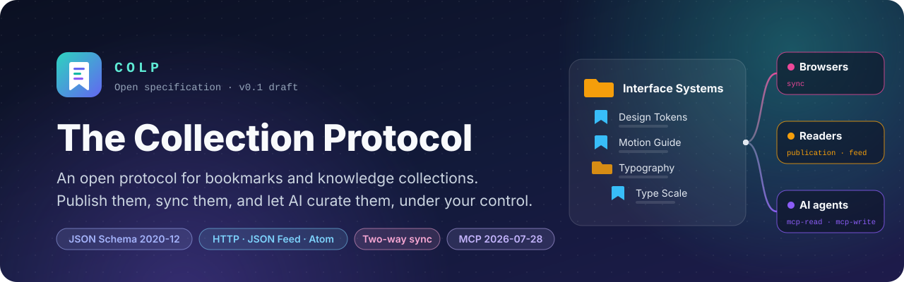
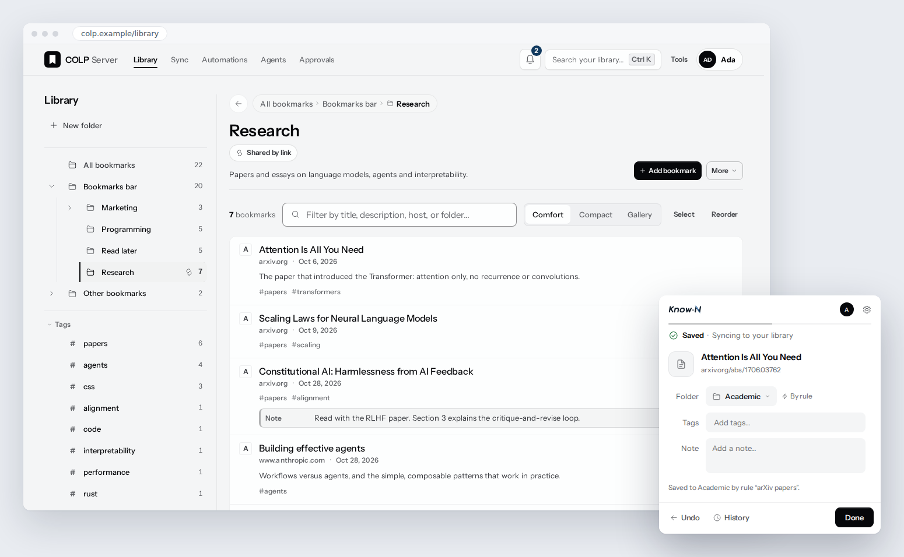
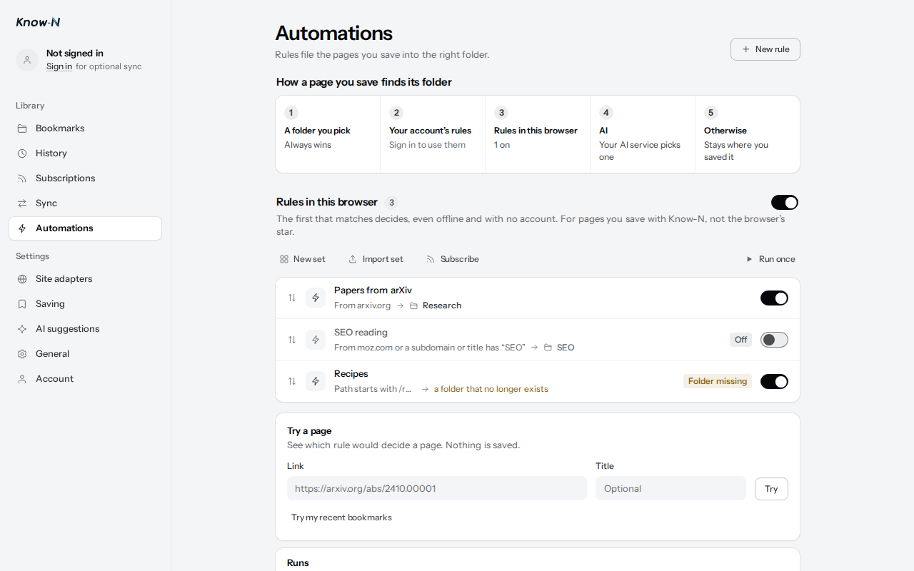
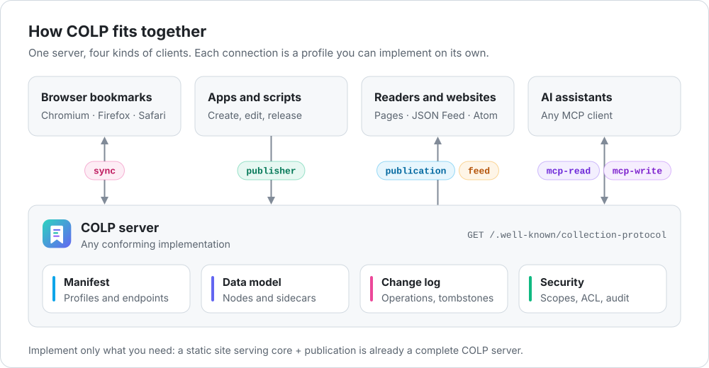
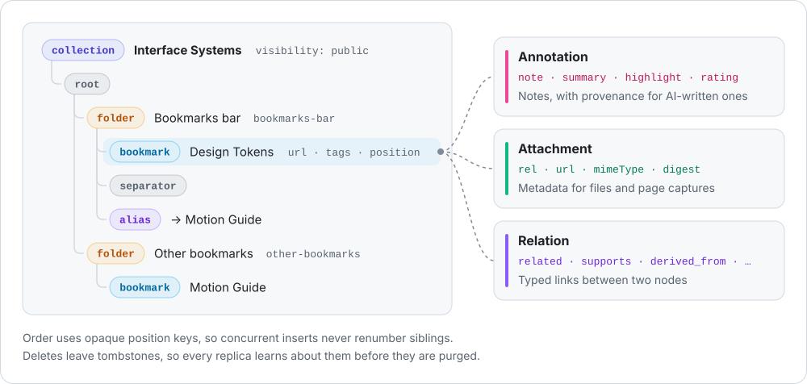
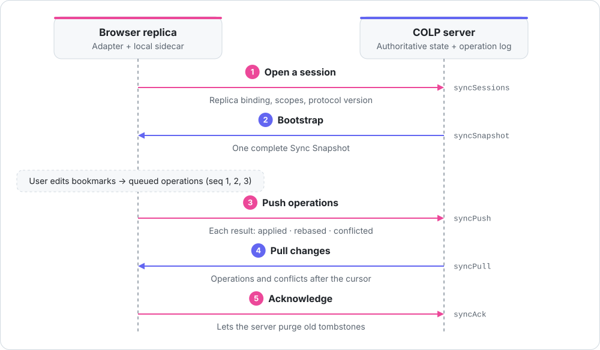
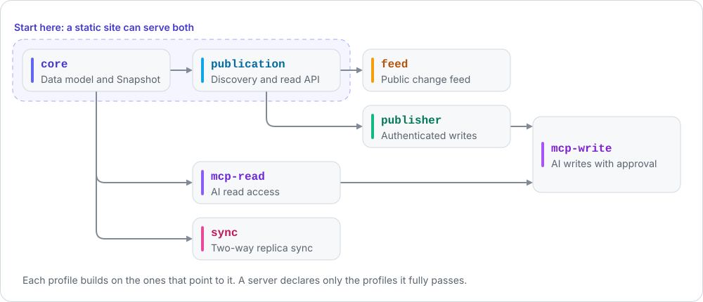

<h1 align="center">
  <picture>
    <source media="(prefers-color-scheme: dark)" srcset="docs/assets/banner.dark.svg">
    
  </picture>
</h1>

<p align="center"><b>Your bookmarks on your own server, in every browser, and safe for AI to organize.</b></p>

<p align="center">
  <a href="deploy/INSTALL.md"><b>Install guide</b></a> ·
  <a href="https://github.com/WhitenWhiten/colp/releases">Releases</a> ·
  <a href="protocol/SPECIFICATION.md">Specification</a>
</p>

<p align="center"><sub><b>English</b> · <a href="README.zh-CN.md">简体中文</a> · <a href="README.ja.md">日本語</a></sub></p>

<p align="center">
  <a href="https://github.com/WhitenWhiten/colp/actions/workflows/colp-ci.yml"></a>
  <a href="protocol/SPECIFICATION.md"></a>
  <a href="protocol/docs/05-mcp-profile.md"></a>
  <a href="packages/node"></a>
  <a href="LICENSE"></a>
</p>

**COLP** keeps your bookmarks in one library on a server you run. The **Know-N** browser extension syncs that library with every browser you use, rules file new saves into the right folder, and AI agents can read and reorganize it over MCP while you approve what they change. Underneath is the **Collection Protocol**, an open, HTTP-native protocol for bookmarks and curated collections, with a reference implementation on npm.

<p align="center">
  
  <br><sub>The library in COLP Server's web app, and the Know-N popup after a rule filed a paper into Academic. Rendered from synthetic data by <code>node scripts/capture-readme.mjs</code>.</sub>
</p>

## Why COLP

- **Your library, your server.** One private library per account, in PostgreSQL on a machine you control. Your bookmarks stay ordinary browser bookmarks, and you can take all your data out at any time.
- **Every browser, one tree.** The extension merges each browser's Bookmarks bar and Other bookmarks into the same library and keeps them in two-way sync. Saving works offline and without an account; sync catches up later.
- **Rules that file for you.** Rules in the browser work offline and without an account. Rules on the server can also tag and summarize what you save.
- **AI that asks first.** Agents such as Claude Code and Codex connect over MCP. Adding a bookmark applies at once; moving or deleting becomes a plan that waits for your approval, and every committed plan can be undone.
- **Share a folder, not your library.** An unlisted, read-only link shows one folder's live contents until you stop sharing it. The library itself always stays private.
- **An open protocol.** A versioned specification, JSON Schemas, executable examples and a conformance runner, so other servers and clients can join in.

## Run your bookmark library

1. **Start COLP Server** on your machine or a small VPS with Docker Compose. The [install guide](deploy/INSTALL.md) covers HTTPS, the first owner account, backups and upgrades.
2. **Install the Know-N extension** for Chrome or another Chromium browser from the [releases page](https://github.com/WhitenWhiten/colp/releases), then enter your server's address under Account → Server and sign in ([details](deploy/INSTALL.md#5-connect-a-browser)).
3. **Review the first sync.** Every folder syncs by default; untick the ones that should stay on this browser. Repeat on each browser, and they converge within a minute.

From then on the web **Library** shows the same tree as your browsers. Read on for what each part does, or go straight to [connecting an agent](deploy/INSTALL.md#6-connect-an-agent).

## One library in every browser

<p align="center">
  
  <br><sub>The web Library with the Research folder open.</sub>
</p>

Each account has one private **Bookmarks** library, with **Bookmarks bar** and **Other bookmarks** ready on first use. Folders you create later sync too. New folders, imports and saved pages go where you choose; nothing is placed in Other bookmarks automatically. The **Sync center** lists connected browsers, conflicts and the trash; **Version history** restores the whole library to an earlier state; **Link health** finds broken links, redirects and duplicates; and **Import** brings in a bookmarks file from any browser or bookmark tool.

## Save and organize in the browser

<p align="center">
  
  <br><sub>Know-N's bookmark manager over the browser's own bookmarks.</sub>
</p>

Press **Alt+S** to save the page you are on, or right-click to save a page or a link: pick a folder, add tags and a note. Know-N manages the browser's own bookmarks, so they stay usable even without the extension, and everything here works without an account. Signing in to your COLP Server adds sync; [the extension README](packages/extension/README.md) has the full feature list and every permission it asks for.

## Rules that file your saves

<p align="center">
  
  <br><sub>Rules in the browser: the first one that matches decides, even offline.</sub>
</p>

A rule says something like "papers from arxiv.org go to Research". The order is always the same: a folder you pick wins, then your account's rules, then this browser's rules, then an AI suggestion if you configured one, and otherwise the page stays where you saved it. Try a page against your rules before saving it, run a rule once over bookmarks you already have, and undo a run. On the server, rules can also tag and summarize: the digests and summaries they write collect under Automations → Digests, and new ones show up in your Activity inbox.

## AI agents, with your approval

<p align="center">
  
  <br><sub>An agent's plan waiting on the Approvals page.</sub>
</p>

Connect Claude Code, Codex, ChatGPT or any MCP client to `/collections/-/mcp-compat` with OAuth, or give a script an API key. Each agent starts on **Manual**: adding bookmarks applies at once, while moves and deletions become a plan on the Approvals page. Switch an agent to **Trusted** to apply its moves directly; you can still undo them. Deleting, emptying the trash and purging always wait for you. The **Activity** inbox shows what your agents added and what is waiting for you.

Once an agent is connected, a prompt to start from:

> Using the colp MCP server, find my bookmark library and read the folder Read later. Propose a plan that files each bookmark into a fitting folder under Bookmarks bar, creating at most three new folders. Do not delete anything. Tell me what you could not place.

## Share a folder

<p align="center">
  
  <br><sub>A shared folder at its unlisted link, as a signed-out visitor sees it.</sub>
</p>

Choose **Share…** on a folder to create an unlisted, read-only link to its live contents, including subfolders. **Stop sharing** disables the link immediately. Shared links never appear in directories, feeds or search indexes, and private items inside the folder stay hidden.

The extension also turns favorites on supported websites into bookmarks: its **Site adapters** page keeps Bilibili favorites in a folder of your choice, with one subfolder per favorites list.

## How the protocol works

This section is the short version. The [five-minute tour](protocol/README.md#colp-in-five-minutes) goes one level deeper, and the [glossary](protocol/GLOSSARY.md) explains every term.

<p align="center">
  <picture>
    <source media="(prefers-color-scheme: dark)" srcset="docs/assets/architecture.dark.svg">
    
  </picture>
</p>

### Data model

<p align="center">
  <picture>
    <source media="(prefers-color-scheme: dark)" srcset="docs/assets/data-model.dark.svg">
    
  </picture>
</p>

A **Collection** is an ordered tree of **Nodes** (`root`, `folder`, `bookmark`, `separator`, `alias`) that maps one-to-one onto a browser bookmark tree. Data that browsers cannot store lives next to the tree as **sidecars**: annotations (notes, summaries, highlights, ratings, with provenance for AI-written ones), attachments, and typed relations. Anything else goes into namespaced `extensions`, which servers preserve verbatim. See [01 Core data model](protocol/docs/01-core-data-model.md).

### Two-way sync

<p align="center">
  <picture>
    <source media="(prefers-color-scheme: dark)" srcset="docs/assets/sync-flow.dark.svg">
    
  </picture>
</p>

Replicas exchange **operations**, not whole trees. Each operation has a per-replica sequence number and the base revision it was made against, so the server can apply it, rebase it, or record a conflict, and a retried push never applies twice. Deletes leave tombstones until every active replica has acknowledged them. See [03 Sync](protocol/docs/03-sync.md) and [06 Browser mapping](protocol/docs/06-browser-mapping.md).

### Profiles

<p align="center">
  <picture>
    <source media="(prefers-color-scheme: dark)" srcset="docs/assets/profiles.dark.svg">
    
  </picture>
</p>

COLP is split into composable conformance profiles. A server declares in its Manifest only the profiles it fully passes, and clients discover everything else from there.

| Profile | What it adds | Spec |
|---|---|---|
| `core` | Objects, strict JSON Schema, semantic checks, complete Snapshot | [01](protocol/docs/01-core-data-model.md) |
| `publication` | Discovery, directory, metadata, paginated snapshots, ETags, Problem Details | [02](protocol/docs/02-http-publication-feed.md) |
| `feed` | Public change stream with cursors, JSON Feed, and Atom | [02](protocol/docs/02-http-publication-feed.md) |
| `publisher` | Authenticated writes with `If-Match`, idempotency keys, and releases | [08](protocol/docs/08-write-api.md) |
| `sync` | Sessions, push, pull, ack, conflicts, and tombstones | [03](protocol/docs/03-sync.md) |
| `mcp-read` | MCP resources and read-only tools | [05](protocol/docs/05-mcp-profile.md) |
| `mcp-write` | MCP write tools, scopes, audit, and plan / commit for high-risk changes | [05](protocol/docs/05-mcp-profile.md) |

## Build on the protocol

### Install from npm

Requires **Node.js 22 or later**. Install the reference implementation in your application:

```bash
npm install @know-n/colp@0.3.0
```

The package includes TypeScript declarations and supports ESM and CommonJS. Save this example as `colp-demo.mjs` to try the package without a server:

```js
import { protocolVersion, supportedProfiles } from '@know-n/colp';
import { createUrlHash } from '@know-n/colp/semantic';

console.log(protocolVersion); // '0.1'
console.log(supportedProfiles); // core, publication, publisher, feed, sync, mcp-read, mcp-write
console.log(createUrlHash('https://example.com/'));
```

```bash
node colp-demo.mjs
```

Import APIs from their subpaths, such as `@know-n/colp/client`, `@know-n/colp/server`, or `@know-n/colp/semantic`. The package root exposes protocol metadata. See the [package README](packages/node/README.md) and [API guide](packages/node/docs/API.md) for validation, HTTP publication, Sync, and MCP examples. The `0.x` APIs may change between minor versions; pin a version when integrating.

### A quick look

Everything starts at a well-known URL. The Manifest tells a client which profiles a server supports and where every endpoint lives, so clients never guess paths:

```http
GET /.well-known/collection-protocol HTTP/1.1
Host: alice.example
Accept: application/vnd.collection-protocol.manifest+json
```

```jsonc
{
  "protocol": "https://know-n.com/colp/spec/0.1",
  "protocolVersions": ["0.1"],
  "serverUuid": "019b3c67-a03c-7f02-9c7e-1ee8d50a77de",
  "title": "Alice's Collections",
  "mounts": [{
    "id": "default",
    "baseUrl": "https://alice.example/collections/",
    "profiles": ["core", "publication", "publisher", "sync", "mcp-read", "mcp-write"],
    "endpoints": {
      "directory": "https://alice.example/collections",
      "collection": "https://alice.example/collections/c/{collectionId}",
      "snapshot": "https://alice.example/collections/c/{collectionId}/snapshot",
      "mcp": "https://alice.example/collections/-/mcp"
      // ... every endpoint the declared profiles require
    }
  }]
}
```

With the Node.js reference implementation, a client follows the Manifest and assembles a complete, validated Snapshot:

```ts
import { ColpClient } from '@know-n/colp/client';

const client = new ColpClient({
  manifestUrl: 'https://alice.example/.well-known/collection-protocol',
});

const manifest = await client.discover();
const snapshot = await client.getSnapshot('interface-systems');
console.log(manifest.title, snapshot.nodes.length);
```

The full example is [`protocol/examples/public-manifest.json`](protocol/examples/public-manifest.json); all 28 examples are validated in CI.

### Try it from a clone

From a fresh clone, build the reference package and run the example server's self-test. It starts a small `core + publication` server, reads everything back through the Manifest with `ColpClient`, and exits:

```bash
git clone https://github.com/WhitenWhiten/colp.git && cd colp
npm run install:package && npm run build
npm run example:publication -- --self-test
```

```text
Manifest:  Example Collections (core, publication)
Directory: 1 collection(s)
Metadata:  Interface Systems
Snapshot:  2 node(s), 1 annotation(s)
```

To poke at it with `curl`, start it without `--self-test` and stop it with Ctrl+C when you are done:

```bash
npm run example:publication
curl -i http://127.0.0.1:8080/.well-known/collection-protocol
```

The server is [one file](packages/node/examples/publication-server.mjs) built on `node:http`; it shows which parts belong to your application and which the package handles for you.

### Check a server

To check that a running COLP server conforms, without cloning this repository:

```bash
npx --yes --package=@know-n/colp-conformance@0.1.1 colp-conformance https://your-server.example
```

Replace the URL with your server's origin or Manifest URL. See the [runner README](packages/conformance/README.md) for options and programmatic usage. Both packages are on npm: [@know-n/colp](https://www.npmjs.com/package/@know-n/colp) and [@know-n/colp-conformance](https://www.npmjs.com/package/@know-n/colp-conformance).

## Find your way

| You want to… | Start with |
|---|---|
| Run your own bookmark server | The [install guide](deploy/INSTALL.md), then the [COLP Server README](packages/server/README.md) |
| Use the browser extension | The [Know-N README](packages/extension/README.md) |
| Connect an AI agent | [Connect an agent](deploy/INSTALL.md#6-connect-an-agent) in the install guide |
| Understand how the protocol works | The [five-minute tour](protocol/README.md#colp-in-five-minutes), then the [glossary](protocol/GLOSSARY.md) |
| Read or validate COLP data from TypeScript or JavaScript | The [package README](packages/node/README.md) and the [API guide](packages/node/docs/API.md) |
| Serve COLP from your own server | The [Publication quickstart](packages/node/docs/PUBLICATION_QUICKSTART.md) and the [example server](packages/node/examples/publication-server.mjs) |
| Implement COLP in another language | [Where to start](protocol/README.md#where-to-start) in the protocol README |
| Contribute | [CONTRIBUTING.md](CONTRIBUTING.md) |

## Repository layout

| Path | Contents |
|---|---|
| [`protocol/`](protocol/README.md) | The specification, its glossary, JSON Schemas, executable examples, and the requirement registry |
| [`packages/node/`](packages/node/README.md) | `@know-n/colp`, the reference implementation in TypeScript, with its tests and [guides](packages/node/docs/README.md) |
| [`packages/conformance/`](packages/conformance/README.md) | `colp-conformance`, a black-box test runner for any COLP server |
| [`packages/server/`](packages/server/README.md) | COLP Server: PostgreSQL storage, the account library, Sync, Automations, MCP for agents, and shared folder links |
| [`packages/web/`](packages/web/README.md) | The web app served by COLP Server |
| [`packages/extension/`](packages/extension/README.md) | Know-N, a Manifest V3 bookmark manager for Chromium browsers that syncs with COLP Server |
| [`deploy/`](deploy/INSTALL.md) | Install and operate the self-hosted stack |
| [`docs/`](docs) | Design notes and evidence, such as the [automation backend](docs/automation/README.md); [`docs/assets/`](docs/assets) holds the README art |
| [`.github/workflows/colp-ci.yml`](.github/workflows/colp-ci.yml) | CI: protocol checks, example validation, type checks, tests, and the evidence check |

Common commands, from the repository root:

```bash
npm test                                   # the package's test suite
npm run check                              # every gate CI runs for the package
npm run conformance -- <server-url>        # test a live server (run `npm --prefix packages/conformance ci` once first)
node scripts/check-readmes.mjs             # the READMEs agree with each other and the packages
node scripts/capture-readme.mjs            # re-render the README screenshots (needs ffmpeg and xvfb)
cd protocol && python scripts/validate_examples.py   # validate the protocol examples (Python 3, see protocol/README.md)
```

## Project status

| Part | Version | State |
|---|---|---|
| Specification | `0.1-draft` | The 0.1 wire contract is closed: every DTO has a stable `$defs` name. The 0.2 additions, authoritative pull effects for Sync, have their own schema and requirement registry. |
| `@know-n/colp` | 0.3.0 | All seven profiles. Every MUST and MUST NOT requirement maps to tests, as listed in [TRACEABILITY.md](packages/node/docs/TRACEABILITY.md). |
| `@know-n/colp-conformance` | 0.1.1 | Anonymous `core + publication` reads. Authenticated reads and the other profiles are next. |
| COLP Server | 0.1.0 release candidates | Library, Sync, sharing, Automations, agents and approvals. Container images on GitHub; see the [changelog](packages/server/CHANGELOG.md). |
| Know-N extension | 0.1.0 release candidates | Installed unpacked from GitHub releases until the stable release reaches the Chrome Web Store; see the [changelog](packages/extension/CHANGELOG.md). |

## Contributing

Issues and pull requests are welcome, and questions and early ideas go to [Discussions](https://github.com/WhitenWhiten/colp/discussions). Read [CONTRIBUTING.md](CONTRIBUTING.md) first; protocol changes should update the spec, schema, examples, and requirement registry together, and README changes should update all three languages. [GOVERNANCE.md](GOVERNANCE.md) explains how changes are decided, and [ROADMAP.md](ROADMAP.md) lists what comes next. Report vulnerabilities privately as described in [SECURITY.md](SECURITY.md). Everyone taking part is expected to follow the [Code of Conduct](CODE_OF_CONDUCT.md).

## License

[Apache License 2.0](LICENSE). The license does not cover the Know-N name, logo or wordmark used by the browser extension; see its [README](packages/extension/README.md#license).
