<h1 align="center">
  <picture>
    <source media="(prefers-color-scheme: dark)" srcset="docs/assets/banner.zh-CN.dark.svg">
    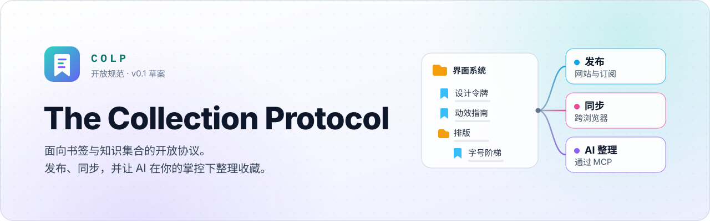
  </picture>
</h1>

<p align="center"><b>书签存在你自己的服务器上，每个浏览器都能用，交给 AI 整理也放心。</b></p>

<p align="center">
  <a href="deploy/INSTALL.md"><b>安装指南</b></a> ·
  <a href="https://github.com/WhitenWhiten/colp/releases">发布版本</a> ·
  <a href="protocol/SPECIFICATION.md">规范</a>
</p>

<p align="center"><sub><a href="README.md">English</a> · <b>简体中文</b> · <a href="README.ja.md">日本語</a></sub></p>

<p align="center">
  <a href="https://github.com/WhitenWhiten/colp/actions/workflows/colp-ci.yml"></a>
  <a href="protocol/SPECIFICATION.md"></a>
  <a href="protocol/docs/05-mcp-profile.md"></a>
  <a href="packages/node"></a>
  <a href="LICENSE"></a>
</p>

**COLP** 把你的书签集中在一个书签库里，放在你自己运行的服务器上。**Know-N** 浏览器扩展把这个书签库同步到你用的每个浏览器；规则会把新保存的网页归入合适的文件夹；AI 智能体可以通过 MCP 读取和重新整理书签库，它们做的改动由你批准。底层是 **Collection Protocol**：一个原生基于 HTTP、面向书签与人工整理集合的开放协议，参考实现已发布到 npm。

<p align="center">
  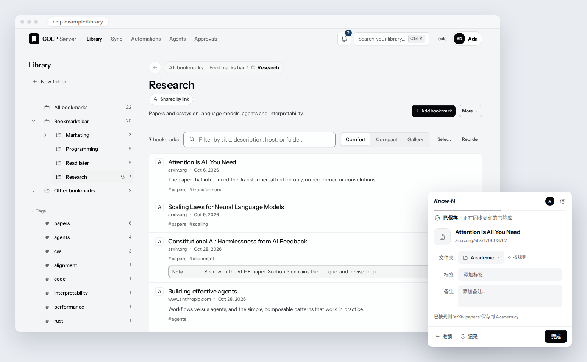
  <br><sub>COLP Server 网页应用中的书签库，以及规则把一篇论文归入 Academic 之后的 Know-N 弹窗。截图由 <code>node scripts/capture-readme.mjs</code> 根据合成数据渲染。</sub>
</p>

## 为什么选择 COLP

- **你的书签库，你的服务器。** 每个账号一个私有书签库，存放在你掌控的机器上的 PostgreSQL 里。书签仍然是普通的浏览器书签，你随时可以把全部数据导出带走。
- **每个浏览器，同一棵树。** 扩展把每个浏览器的“书签栏”和“其他书签”合并进同一个书签库，并保持双向同步。离线、没有账号也能保存，同步稍后会补上。
- **规则替你归档。** 浏览器里的规则离线也能用，也不需要账号。服务器上的规则还能给你保存的内容加标签、写摘要。
- **AI 会先问你。** Claude Code、Codex 等智能体通过 MCP 连接。添加书签会立即生效；移动或删除则先变成一份计划，等你批准，而且每个已提交的计划都可以撤销。
- **分享文件夹，而不是整个书签库。** 一个不公开列出的只读链接会实时展示某个文件夹的内容，直到你停止分享。书签库本身始终是私有的。
- **开放的协议。** 带版本号的规范、JSON Schema、可执行示例和一致性测试工具，其他服务器和客户端也可以加入进来。

## 运行你的书签库

1. **启动 COLP Server**：在你自己的机器或一台小型 VPS 上用 Docker Compose 运行。[安装指南](deploy/INSTALL.md) 介绍了 HTTPS、第一个所有者账号、备份和升级。
2. **安装 Know-N 扩展**：从 [发布页面](https://github.com/WhitenWhiten/colp/releases) 获取，装到 Chrome 或其他 Chromium 浏览器上，然后在扩展的“账号 → 服务器”中填写你的服务器地址并登录（[详细步骤](deploy/INSTALL.md#5-connect-a-browser)）。
3. **检查首次同步。** 默认所有文件夹都会同步；取消勾选那些只想留在当前浏览器里的文件夹。在每个浏览器上重复一遍，一分钟之内它们就会一致。

此后，网页版 **Library**（书签库）显示的就是和你的浏览器相同的那棵树。继续往下读可以了解各部分的作用，也可以直接跳到 [连接智能体](deploy/INSTALL.md#6-connect-an-agent)。

## 一个书签库，所有浏览器

<p align="center">
  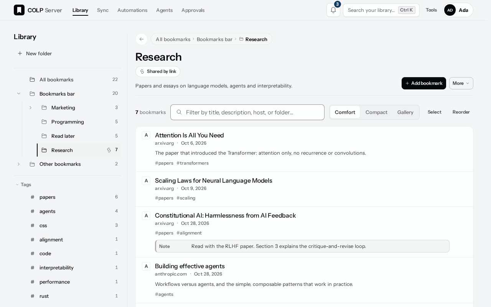
  <br><sub>网页版 Library，打开了 Research 文件夹。</sub>
</p>

每个账号有一个私有的 **Bookmarks** 书签库，首次使用时就已经建好 **Bookmarks bar**（书签栏）和 **Other bookmarks**（其他书签）。之后新建的文件夹同样会同步。新建的文件夹、导入的书签和保存的网页都放在你选择的位置，不会被自动放进 Other bookmarks。**Sync center**（同步中心）列出已连接的浏览器、冲突和回收站；**Version history**（版本历史）可以把整个书签库恢复到之前的某个状态；**Link health**（链接健康）会找出失效链接、重定向和重复项；**Import**（导入）可以导入任何浏览器或书签工具导出的书签文件。

## 在浏览器中保存和整理

<p align="center">
  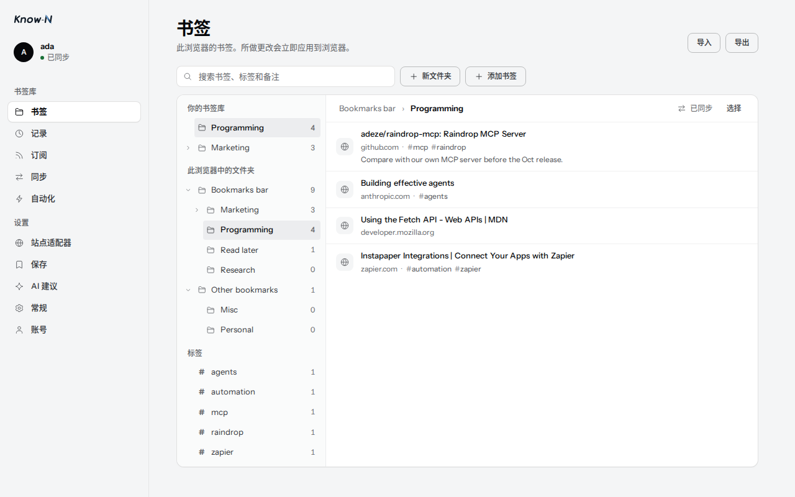
  <br><sub>Know-N 的书签管理器，管理的就是浏览器自己的书签。</sub>
</p>

按 **Alt+S** 保存当前页面，或者在右键菜单里保存网页或链接：选一个文件夹，加上标签和备注。Know-N 管理的是浏览器自己的书签，所以即使没有这个扩展，书签也照样能用；这里的一切都不需要账号。登录你的 COLP Server 后就多了同步功能；完整的功能列表和扩展申请的每一项权限见 [扩展 README](packages/extension/README.md)。

## 让规则替你归档

<p align="center">
  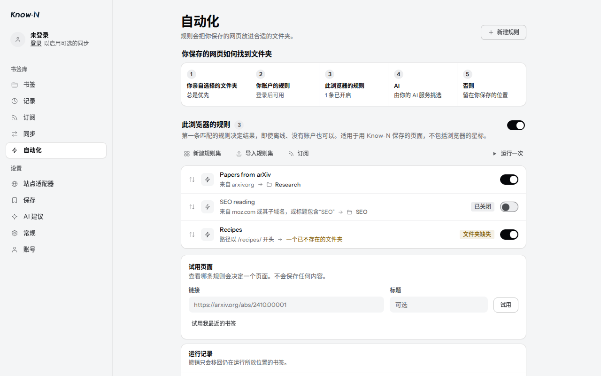
  <br><sub>浏览器中的规则：第一条匹配的规则决定结果，离线时也一样。</sub>
</p>

一条规则说的是类似“来自 arxiv.org 的论文放进 Research”这样的事。判断顺序始终不变：你亲自选择的文件夹优先，其次是你账号的规则，再次是此浏览器的规则，然后是 AI 建议（如果你配置了的话），都没有命中时，网页就留在你保存的位置。保存之前可以用“试用页面”看看规则会怎样处理一个网页，用“运行一次”把规则套用到已有的书签上，运行之后也可以撤销。在服务器上，规则还能加标签、写摘要：它们写出的摘要和总结汇总在 **Automations → Digests**（自动化 → 摘要）下，新的摘要会出现在 **Activity**（动态）收件箱里。

## AI 智能体，经你批准

<p align="center">
  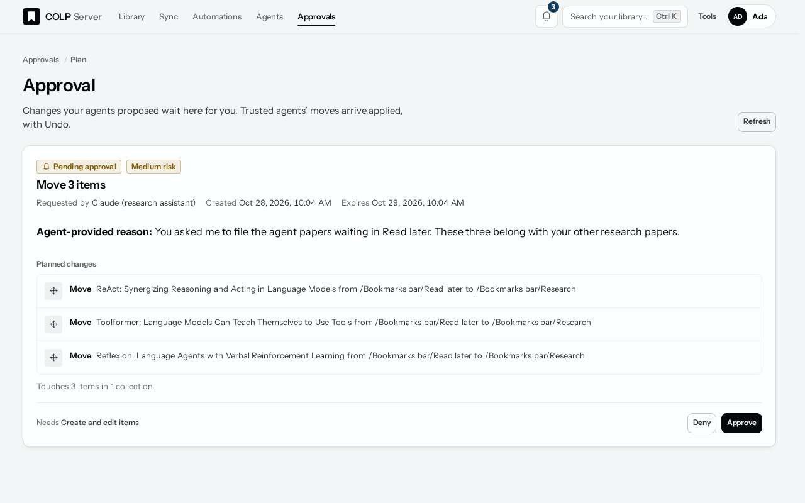
  <br><sub>一个智能体的计划，正在 Approvals 页面上等你处理。</sub>
</p>

用 OAuth 把 Claude Code、Codex、ChatGPT 或任何 MCP 客户端连接到 `/collections/-/mcp-compat`，或者给脚本一个 API 密钥。每个智能体一开始都是 **Manual**（手动）模式：添加书签会立即生效，移动和删除则变成 **Approvals**（审批）页面上的一份计划。把智能体切换为 **Trusted**（信任）后，它的移动会直接执行，之后仍然能撤销。删除、清空回收站和彻底清除永远要等你批准。**Activity** 收件箱会显示智能体添加了什么、哪些事在等你处理。

连上智能体之后，可以从这段提示词开始：

> 使用 colp MCP 服务器，找到我的书签库，读取“稍后阅读”文件夹。提出一份计划，把其中每个书签归入 Bookmarks bar（书签栏）下合适的文件夹，最多新建三个文件夹。不要删除任何内容。告诉我哪些书签没能归类。

## 分享文件夹

<p align="center">
  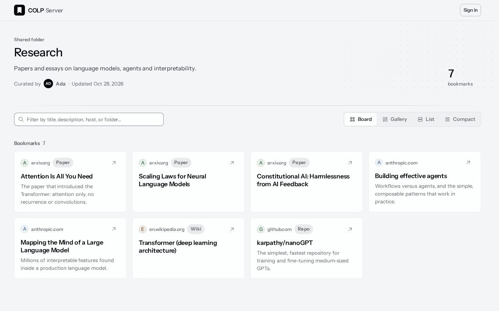
  <br><sub>不公开列出的链接上的共享文件夹，也就是未登录访客看到的样子。</sub>
</p>

在文件夹上选择 **Share…**（分享），就会生成一个不公开列出的只读链接，实时展示文件夹的内容，包括子文件夹。**Stop sharing**（停止分享）会立即让链接失效。分享链接永远不会出现在目录、Feed 或搜索索引中，文件夹里的私有条目也始终隐藏。

扩展还能把受支持网站上的收藏变成书签：它的 **站点适配器** 页面会把 Bilibili 收藏保存到你选择的文件夹里，每个收藏夹对应其中的一个子文件夹。

## 协议如何工作

这里是简短版本。[五分钟了解 COLP](protocol/README.zh-CN.md#五分钟了解-colp) 会再深入一层，[术语表（英文）](protocol/GLOSSARY.md) 解释了每个术语。

<p align="center">
  <picture>
    <source media="(prefers-color-scheme: dark)" srcset="docs/assets/architecture.zh-CN.dark.svg">
    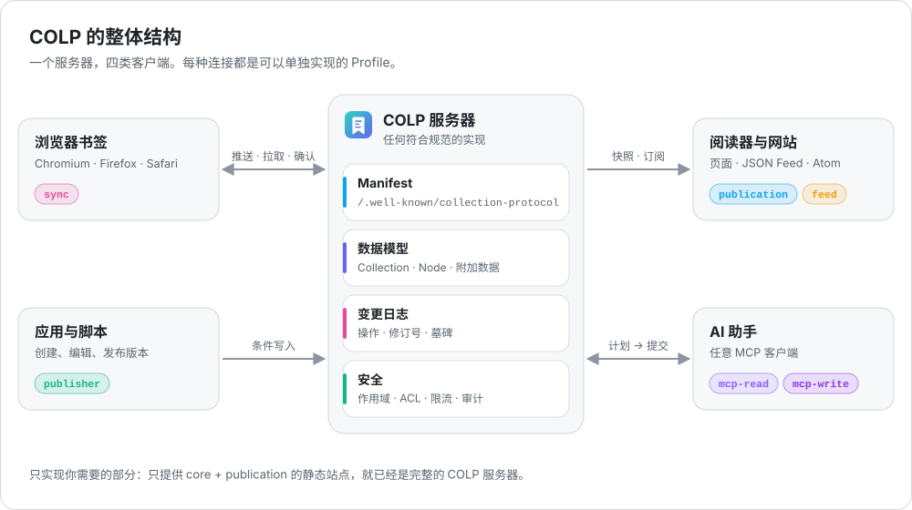
  </picture>
</p>

### 数据模型

<p align="center">
  <picture>
    <source media="(prefers-color-scheme: dark)" srcset="docs/assets/data-model.zh-CN.dark.svg">
    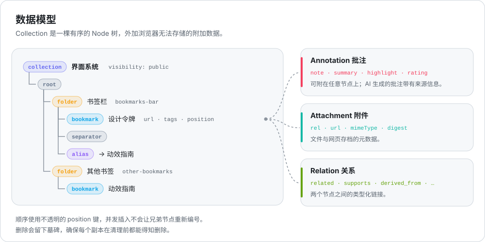
  </picture>
</p>

**Collection** 是一棵有序的 **Node** 树（`root`、`folder`、`bookmark`、`separator`、`alias`），与浏览器书签树一一对应。浏览器无法存储的数据作为 **附加数据（sidecar）** 放在树旁边：批注（笔记、摘要、高亮、评分；AI 生成的批注带有来源信息）、附件，以及带类型的关系。其他数据放进带命名空间的 `extensions`，服务器会原样保留。详见 [01 核心数据模型](protocol/docs/01-core-data-model.md)。

### 双向同步

<p align="center">
  <picture>
    <source media="(prefers-color-scheme: dark)" srcset="docs/assets/sync-flow.zh-CN.dark.svg">
    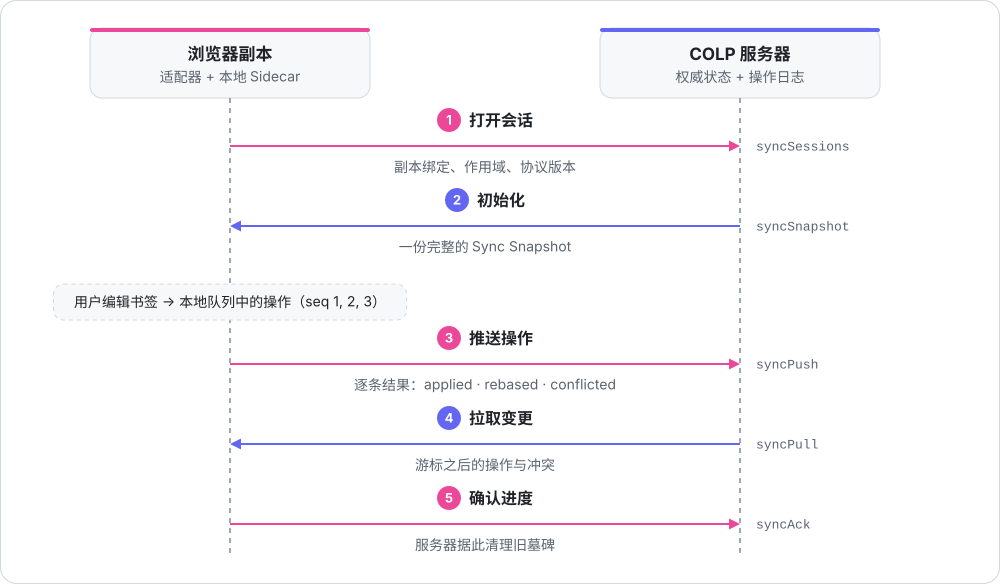
  </picture>
</p>

副本之间交换的是 **操作**，而不是整棵树。每个操作都带有副本内的序号和它所基于的修订号，服务器可以直接应用、变基或记录冲突，重试的推送也不会被重复应用。删除会留下墓碑，直到所有活跃副本都确认过之后才清理。详见 [03 同步](protocol/docs/03-sync.md) 与 [06 浏览器映射](protocol/docs/06-browser-mapping.md)。

### Profile

<p align="center">
  <picture>
    <source media="(prefers-color-scheme: dark)" srcset="docs/assets/profiles.zh-CN.dark.svg">
    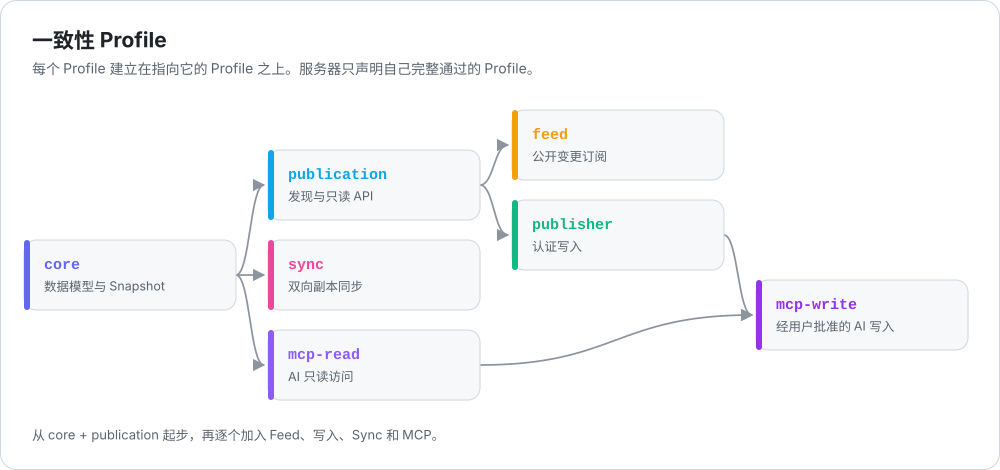
  </picture>
</p>

COLP 拆分为可组合的一致性 Profile。服务器只在 Manifest 中声明自己完整通过的 Profile，客户端从 Manifest 发现其余一切。

| Profile | 提供的能力 | 规范 |
|---|---|---|
| `core` | 核心对象、严格的 JSON Schema、语义校验、完整 Snapshot | [01](protocol/docs/01-core-data-model.md) |
| `publication` | 发现、目录、元信息、分页快照、ETag、Problem Details | [02](protocol/docs/02-http-publication-feed.md) |
| `feed` | 带游标的公开变更流、JSON Feed 与 Atom | [02](protocol/docs/02-http-publication-feed.md) |
| `publisher` | 带 `If-Match`、幂等键与版本发布的认证写入 | [08](protocol/docs/08-write-api.md) |
| `sync` | 会话、推送、拉取、确认、冲突与墓碑 | [03](protocol/docs/03-sync.md) |
| `mcp-read` | MCP Resources 与只读 Tools | [05](protocol/docs/05-mcp-profile.md) |
| `mcp-write` | MCP 写入 Tools、作用域、审计，以及高风险变更的计划 / 提交 | [05](protocol/docs/05-mcp-profile.md) |

## 基于协议开发

### 通过 npm 安装

需要 **Node.js 22 或更高版本**。在你的应用中安装参考实现：

```bash
npm install @know-n/colp@0.3.0
```

包内附带 TypeScript 类型声明，同时支持 ESM 和 CommonJS。将下面的示例保存为 `colp-demo.mjs`，无需服务器即可试用这个包：

```js
import { protocolVersion, supportedProfiles } from '@know-n/colp';
import { createUrlHash } from '@know-n/colp/semantic';

console.log(protocolVersion); // '0.1'
console.log(supportedProfiles); // core, publication, publisher, feed, sync, mcp-read, mcp-write
console.log(createUrlHash('https://example.com/'));
```

```bash
node colp-demo.mjs
```

按用途从子路径导入 API，例如 `@know-n/colp/client`、`@know-n/colp/server` 或 `@know-n/colp/semantic`；包根路径提供协议元信息。校验、HTTP 发布、同步和 MCP 的示例见 [包 README](packages/node/README.md) 与 [API 指南](packages/node/docs/API.md)。`0.x` 的 API 可能随次版本更新而变化，集成时请固定版本。

### 快速一览

一切都从一个 well-known URL 开始。Manifest 告诉客户端服务器支持哪些 Profile、每个端点在哪里，因此客户端从不猜测路径：

```http
GET /.well-known/collection-protocol HTTP/1.1
Host: alice.example
Accept: application/vnd.collection-protocol.manifest+json
```

```jsonc
{
  "protocol": "https://know-n.com/colp/spec/0.1",
  "protocolVersions": ["0.1"],
  "serverUuid": "019b3c67-a03c-7f02-9c7e-1ee8d50a77de",
  "title": "Alice's Collections",
  "mounts": [{
    "id": "default",
    "baseUrl": "https://alice.example/collections/",
    "profiles": ["core", "publication", "publisher", "sync", "mcp-read", "mcp-write"],
    "endpoints": {
      "directory": "https://alice.example/collections",
      "collection": "https://alice.example/collections/c/{collectionId}",
      "snapshot": "https://alice.example/collections/c/{collectionId}/snapshot",
      "mcp": "https://alice.example/collections/-/mcp"
      // ... every endpoint the declared profiles require
    }
  }]
}
```

使用 Node.js 参考实现时，客户端跟随 Manifest，组装出一份完整且经过校验的 Snapshot：

```ts
import { ColpClient } from '@know-n/colp/client';

const client = new ColpClient({
  manifestUrl: 'https://alice.example/.well-known/collection-protocol',
});

const manifest = await client.discover();
const snapshot = await client.getSnapshot('interface-systems');
console.log(manifest.title, snapshot.nodes.length);
```

完整示例见 [`protocol/examples/public-manifest.json`](protocol/examples/public-manifest.json)；全部 28 个示例都在 CI 中校验。

### 克隆仓库试一试

在新克隆的仓库中构建参考包，然后运行示例服务器的自检。它会启动一个 `core + publication` 的小服务器，用 `ColpClient` 从 Manifest 出发把全部内容读一遍，然后退出：

```bash
git clone https://github.com/WhitenWhiten/colp.git && cd colp
npm run install:package && npm run build
npm run example:publication -- --self-test
```

```text
Manifest:  Example Collections (core, publication)
Directory: 1 collection(s)
Metadata:  Interface Systems
Snapshot:  2 node(s), 1 annotation(s)
```

如果想用 `curl` 手动访问，去掉 `--self-test` 启动它，用完后按 Ctrl+C 停止：

```bash
npm run example:publication
curl -i http://127.0.0.1:8080/.well-known/collection-protocol
```

这个服务器只有 [一个文件](packages/node/examples/publication-server.mjs)，基于 `node:http`，从中可以看出哪些部分属于你的应用、哪些由包替你处理。

### 检查服务器

无需克隆本仓库，就能检查一个运行中的 COLP 服务器是否符合规范：

```bash
npx --yes --package=@know-n/colp-conformance@0.1.1 colp-conformance https://your-server.example
```

将 URL 替换为你的服务器源地址或 Manifest URL。命令选项和编程调用方式见 [测试工具 README](packages/conformance/README.md)。两个包都已发布到 npm：[@know-n/colp](https://www.npmjs.com/package/@know-n/colp) 和 [@know-n/colp-conformance](https://www.npmjs.com/package/@know-n/colp-conformance)。

## 找到你的入口

| 你想…… | 从这里开始 |
|---|---|
| 运行自己的书签服务器 | [安装指南](deploy/INSTALL.md)，然后是 [COLP Server README](packages/server/README.md) |
| 使用浏览器扩展 | [Know-N README](packages/extension/README.md) |
| 连接 AI 智能体 | 安装指南中的 [连接智能体](deploy/INSTALL.md#6-connect-an-agent) |
| 了解协议如何工作 | [五分钟了解 COLP](protocol/README.zh-CN.md#五分钟了解-colp)，然后是 [术语表（英文）](protocol/GLOSSARY.md) |
| 用 TypeScript 或 JavaScript 读取、校验 COLP 数据 | [包 README](packages/node/README.md) 与 [API 指南](packages/node/docs/API.md) |
| 在自己的服务器上提供 COLP | [Publication 快速上手](packages/node/docs/PUBLICATION_QUICKSTART.md) 与 [示例服务器](packages/node/examples/publication-server.mjs) |
| 用另一种语言实现 COLP | 协议导读中的 [从哪里开始](protocol/README.zh-CN.md#从哪里开始) |
| 参与贡献 | [CONTRIBUTING.md](CONTRIBUTING.md) |

## 仓库结构

| 路径 | 内容 |
|---|---|
| [`protocol/`](protocol/README.zh-CN.md) | 规范、术语表、JSON Schema、可执行示例与需求注册表 |
| [`packages/node/`](packages/node/README.md) | `@know-n/colp`：TypeScript 参考实现，以及测试与 [使用指南](packages/node/docs/README.md) |
| [`packages/conformance/`](packages/conformance/README.md) | `colp-conformance`：适用于任何 COLP 服务器的黑盒测试工具 |
| [`packages/server/`](packages/server/README.md) | COLP Server：PostgreSQL 存储、账号书签库、同步、自动化、面向智能体的 MCP，以及文件夹分享链接 |
| [`packages/web/`](packages/web/README.md) | COLP Server 提供的网页应用 |
| [`packages/extension/`](packages/extension/README.md) | Know-N：面向 Chromium 浏览器的 Manifest V3 书签管理器，与 COLP Server 同步 |
| [`deploy/`](deploy/INSTALL.md) | 安装和运维自托管的整套服务 |
| [`docs/`](docs) | 设计笔记与证据，例如 [自动化后端](docs/automation/README.md)；[`docs/assets/`](docs/assets) 存放 README 的配图 |
| [`.github/workflows/colp-ci.yml`](.github/workflows/colp-ci.yml) | CI：协议检查、示例校验、类型检查、测试与证据检查 |

常用命令（在仓库根目录运行）：

```bash
npm test                                   # the package's test suite
npm run check                              # every gate CI runs for the package
npm run conformance -- <server-url>        # test a live server (run `npm --prefix packages/conformance ci` once first)
node scripts/check-readmes.mjs             # the READMEs agree with each other and the packages
node scripts/capture-readme.mjs            # re-render the README screenshots (needs ffmpeg and xvfb)
cd protocol && python scripts/validate_examples.py   # validate the protocol examples (Python 3, see protocol/README.md)
```

## 项目状态

| 组成部分 | 版本 | 状态 |
|---|---|---|
| 规范 | `0.1-draft` | 0.1 的 Wire Contract 已收口：每个 DTO 都有稳定的 `$defs` 名称。0.2 新增的内容（Sync 的权威 Pull Effect）有自己的 Schema 和 Requirement Registry。 |
| `@know-n/colp` | 0.3.0 | 实现全部七个 Profile。每条 MUST 与 MUST NOT 需求都对应到测试，见 [TRACEABILITY.md](packages/node/docs/TRACEABILITY.md)。 |
| `@know-n/colp-conformance` | 0.1.1 | 覆盖匿名的 `core + publication` 读取。带认证的读取和其他 Profile 将在后续加入。 |
| COLP Server | 0.1.0 候选版本 | 书签库、同步、分享、自动化、智能体与审批。容器镜像发布在 GitHub；见 [更新日志](packages/server/CHANGELOG.md)。 |
| Know-N 扩展 | 0.1.0 候选版本 | 在稳定版上架 Chrome 应用商店之前，从 GitHub Releases 下载后以未打包方式安装；见 [更新日志](packages/extension/CHANGELOG.md)。 |

## 参与贡献

欢迎提交 Issue 与 Pull Request；问题与早期想法请发到 [Discussions](https://github.com/WhitenWhiten/colp/discussions)。请先阅读 [CONTRIBUTING.md](CONTRIBUTING.md)；协议变更需要同时更新规范、Schema、示例与需求注册表，README 的修改需要同时更新三种语言的版本。[GOVERNANCE.md](GOVERNANCE.md) 说明了变更如何决定，[ROADMAP.md](ROADMAP.md) 列出了接下来的计划。安全漏洞请按 [SECURITY.md](SECURITY.md) 私下报告。所有参与者都应遵守 [行为准则](CODE_OF_CONDUCT.md)。

## 许可证

[Apache License 2.0](LICENSE)。该许可证不涵盖浏览器扩展使用的 Know-N 名称、标志和字标，详见其 [README](packages/extension/README.md#license)。
