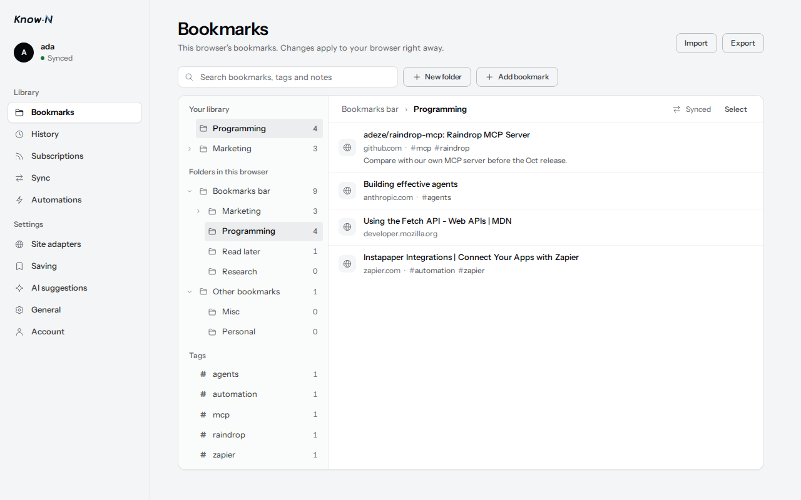
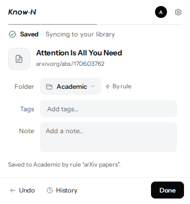
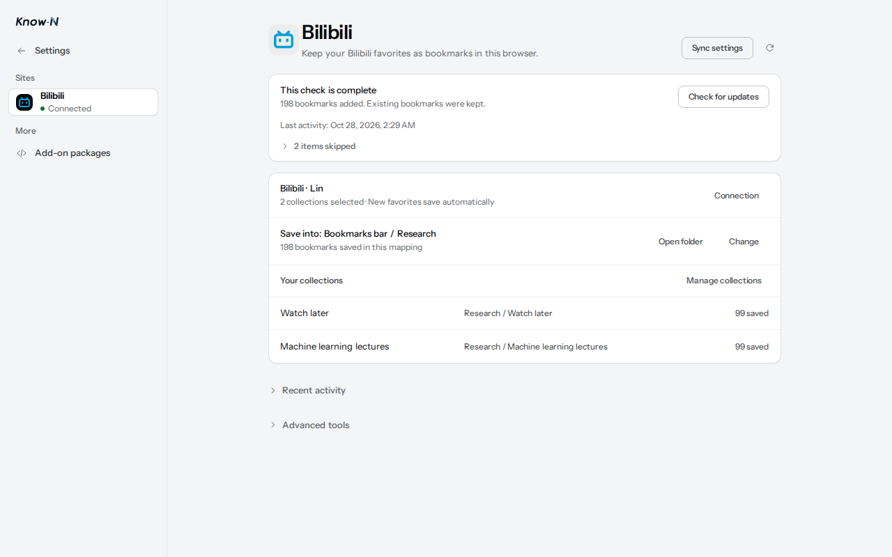

# Know-N for Chrome

A bookmark manager for Chromium browsers. Save the page you are on, tag it, add a note, and organize the
browser's own bookmarks from one place. Rules file new saves into the right folder, and favorites on supported
websites become bookmarks too. Everything works on this browser without an account. When you want, sign in to
your [COLP Server](../server/README.md) to keep the same library in every browser.

<p align="center">
  
  <br><sub>The bookmark manager over the browser's own bookmarks. Screenshots come from <code>npm run shots</code>, which renders the real pages against a stubbed browser API.</sub>
</p>

## What works without an account



- **Saving.** The toolbar button (Alt+S), the page and link menus, and Save tabs for a whole window. Saves go
  into a folder you choose in the browser's bookmarks, so they stay usable even if you remove the extension.
  An explicitly configured default folder can also be used; Other bookmarks is never an implicit destination.
- **Rules.** Automations file the pages you save: the first rule that matches decides, offline and without an
  account, and a folder you pick yourself always wins. Try a page against your rules, run a rule once over
  bookmarks you already have and undo the run, group rules in sets, and share a rules file or subscribe to one.
- **Risk alerts.** Optionally warn when a page you save, or a page you open, is on a list you subscribe to.
  Alerts never block a page or move a bookmark.
- **Organizing.** A bookmark manager over the browser's tree, with tags, notes and folder descriptions,
  search, batch moves and deletes, and pins.
- **History.** A record of what you saved on this browser and how each save went.
- **Import and export.** Import an HTML bookmarks file into a new folder. Export an HTML file that works in any
  browser, or a Know-N backup that also keeps tags, notes, history and settings.
- **AI suggestions with your own provider.** Folder and tag suggestions through an AI service you configure.
  Requests go straight from the browser to that provider; the key stays on this browser.

<br clear="right">

## Website favorites

<p align="center">
  
  <br><sub>Site adapters keeping two Bilibili collections in a Research folder.</sub>
</p>

**Settings → Site adapters** turns favorites on supported websites into bookmarks. Today that is Bilibili:
connect the account you are signed in with, choose collections and a folder, and the first check imports what is
already there after you approve its preview. New favorites then save automatically, one folder per collection.
Removing a favorite on the website keeps the bookmark. Bookmarks are written locally first and sync like any
other once you sign in. The page shows each check's progress, items that need review, and its history.

## What an account adds

Signing in automatically connects your account’s private bookmark library. Open **Sync → Folders** to review
this browser’s whole bookmark tree and start the first sync. Every folder syncs by default; untick a folder
to keep it on this browser only. After first sync, **Folders kept on this browser** uses the same tree.
Review range changes before applying them. For a previously synced folder, you can keep the cloud copy or
send it to the cloud trash; the folder and its bookmarks stay in this browser. Tick it again to sync it.
You can pause or disconnect sync at any time; local bookmarks are kept.

- **Sync.** Bookmarks bar, Other bookmarks, and Mobile bookmarks when available merge with the same folders
  in your library. New folders inside synced roots sync automatically. Tags, notes and folder descriptions
  sync only if you explicitly connect browser metadata under **Sync → Status**.
- **Your account's rules.** Rules kept on the server apply here too, ahead of this browser's rules.
- **Subscriptions.** Collections and digests you follow appear as read-only folders.
- **Know-N suggestions.** Folder and tag suggestions billed in Know-N credits.

The extension shares its sign-in with know-n.com in the same browser: signing in or out in one does the same in
the other.

## Connect to COLP Server

Create the owner account on your COLP Server first. Then open the extension's **Account** page, enter the
server origin in **Server**, and allow access when Chrome asks. The extension checks the server's COLP
Manifest before saving the address. Sign in with your username and password. Your library connects
automatically; review the browser tree under **Sync → Folders**, untick any folders to keep on this browser,
then start sync. The first-run card merges Bookmarks bar, Other bookmarks and Mobile bookmarks when present.
You can find the same tree on the server's web **Library** page and share individual folders there through
**Share…**. Anyone with the link can view that folder's live contents until you **Stop sharing**.
A server that does not yet provide the library endpoint is shown as unsupported, and no bookmark sync runs.
Leave Server empty to use Know-N.

Use HTTPS for remote and home-network servers. For private HTTPS, trust the server's local CA in Chrome
first. Plain HTTP is supported only on `localhost`, `127.0.0.1`, or `[::1]`, after you acknowledge the
unencrypted connection. The server must also enable `COLP_INSECURE_HTTP=true`.

Changing the server signs out the previous connection before saving the new address. **Disconnect server**
forgets the custom origin and its optional permission. Both actions keep your browser bookmarks.
An administrator-managed Server field is locked.

The default self-hosted edition offers username/password sign-in and hides cloud-only account features.
For a forgotten owner password, run this from the server's `deploy` directory:

```sh
docker compose exec server colp-server reset-password --username alice
```

## Permissions

| Permission | Why |
|---|---|
| `bookmarks` (optional) | Read and change the browser's bookmarks. Asked for on first use; removable under General. |
| `tabs` (optional) | List a window's tabs for Save tabs, and check the page you open when risk alerts cover browsing. Saving the current page uses `activeTab` instead. |
| `webNavigation` (optional) | Notice page loads for risk alerts while browsing, and on the websites you turn on under Site adapters. |
| `scripting` (optional) | Run a site adapter on the websites you turn on, and nowhere else. |
| `userScripts` (optional) | Run add-on site packages you install yourself. Chrome also asks you to allow user scripts. |
| `activeTab` | Read the title and address of the page you save, only when you ask to save it. |
| `contextMenus` | The Save this page and Save this link menu items. |
| `storage`, `unlimitedStorage` | Tags, notes, history and settings kept on this browser. |
| `alarms` | Retry saves and sync work after the browser restarts or goes offline. |
| `favicon` | Show site icons in the bookmark manager. |
| `cookies` | Share the know-n.com sign-in session. Only Know-N's own cookie is read or written. |
| Know-N host access | Talk to the Know-N server for sign-in and sync. |
| Other host access (optional) | Requested only for an address you choose: your COLP Server, your AI provider, a rules or risk list you subscribe to, or a website you turn on under Site adapters. |

Tags, notes, folder descriptions, history and settings live in the extension's storage. Removing the extension
deletes them, except what you have chosen to sync with your library; export a Know-N backup to keep a copy. Privacy policy:
<https://know-n.com/privacy>.

## Building from source

The extension lives in `packages/extension` of the COLP repository. It builds from this repository alone, with
Node 22 or later:

- `@know-n/colp` from npm;
- `packages/server/generated/openapi/product-v1.ts`, for the Product API types (type-only, nothing from the
  server is bundled);
- `design/`, Know-N's design tokens, component styles, icon paths and wordmark, copied from the Know-N web app
  so the extension keeps the same look. Update them there and copy them here; do not restyle them in place.

```text
cd packages/extension
npm ci
npm run build:development   # dist/development, for a local server
npm run build               # dist/production
npm run package             # dist/production plus dist/known-extension-<version>.zip for the store
```

After upgrading `@know-n/colp`, run `node scripts/generate-bookmark-operation-validators.mjs`
and commit the regenerated validators. Builds check that they match the installed protocol schema.

`src/generated/classification/` is generated from the Know-N server's classification policy. Know-N
regenerates it and checks it for drift; do not edit it here.

Load the output folder as an unpacked extension from `chrome://extensions`. Each build embeds its default
server configuration from `config/`; Account's Server field can override it at runtime. The server must allow
the extension ID, which `manifest.base.json` fixes through its `key`. For a custom build ID, set the server's
`COLP_ALLOWED_EXTENSION_IDS` accordingly.

To update an unpacked installation, replace the files in the same directory and reload it at
`chrome://extensions`. Keeping the directory keeps the extension's identity and its stored sync state; do not
clear its storage to recover from a sync problem.

## Releases

The extension has its own SemVer in `package.json` and its own [CHANGELOG](CHANGELOG.md).
`manifest.base.json` uses numeric `X.Y.Z.N` for an RC (N is 1–65534) and `version_name` set to the full
`X.Y.Z-rc.N`, matching `package.json`. The final release uses `X.Y.Z.65535` and `version_name: X.Y.Z`
so Chrome upgrades it after every RC; stable versions without preceding RCs may also use plain `X.Y.Z`.
Pushing a tag `extension-vX.Y.Z` or `extension-vX.Y.Z-rc.N`
runs `.github/workflows/colp-extension-release.yml`:
it checks the versions and the CHANGELOG section, builds and scans the production extension, and attaches the
zip to a GitHub release. RC tags create pre-releases without moving the latest release.
RCs are distributed through GitHub for unpacked installation. Upload stable release zips to the Chrome
Web Store by hand.

## Checks

```text
npm run typecheck
npm run lint
npm run check:i18n
npm test                    # unit tests (Vitest)
npm run test:e2e:local-first   # browser tests, run under xvfb on Linux
npm run test:e2e            # everything, against COLP Server in a temporary Postgres
npm run shots               # render the options pages and popup with a stubbed browser API, for review
```

The unit and browser tests import `packages/server`, so run `npm ci` there too; cross-application browser fixtures also require `npm ci` in `packages/web`. Browser tests run a real Chromium
and must run under xvfb (`scripts/with-xvfb.mjs`). The required `extension-browser` CI job runs every core spec across six shards, including multi-device recovery. The subscription capacity measurement is opt-in: `npm run evidence:bookmark-subscriptions:capacity`.
The `self-hosted-browser` job runs the cross-application and layout specs against the production CLI and built Web application, with a disposable database and owner; `npm run test:e2e:self-hosted` runs it locally. It closes the application and removes the database even when a browser test fails. No external server or saved owner credentials are required.

Sync Snapshot validation applies its 500-node / 2 MiB limits to each page.
Complete libraries may exceed 10,000 nodes and 2 MiB; bootstrap reads and validates
each new page once. Untrusted import-document and classification-context budgets
are independent of the size of an existing synced library.

Four inherited cloud-only specs (capture apply, credits ledger, Product classification, and the billed cloud/local classification comparison) are retired with the server modules they imported. The shipped local-provider path remains covered by `mv3-manual-classification.spec.ts` and disclosure/security tests. The old mixed cloud-classification/placement spec is replaced by its signed-out offline placement case; real placement and recovery specs remain. The inherited Digest-edition browser journey depended on Know-N’s report reader, which this server does not ship; its replacement verifies explicit capability denial and zero native or remote writes. Digest projection semantics remain in the subscription unit suites. Favicon capture, replay, policy and clear tests run against the restored self-hosted helper. The multi-device recovery test now owns two real Chromium profiles and a PostgreSQL fixture instead of requiring a private external runner.

The README screenshots come from `node scripts/capture-readme.mjs` at the repository root, which runs `npm run shots`
for a fixed set of states in English and Simplified Chinese with a pinned clock (`SHOT_TIME`).

## Languages

English and Simplified Chinese. Copy lives at the call site; `npm run i18n:write` regenerates
`_locales/en/messages.json`, and `npm run check:i18n` checks translations against it.

## More

- [docs/engineering-notes.md](docs/engineering-notes.md): sync engine, storage and CI notes.
- [docs/ui-design.md](docs/ui-design.md): layout and component rules.
- [Site adapter foundation](docs/site-adapters/runtime-foundation.md): implemented website favorites integration, copy identities, independent semantic saving, reconciliation and adapter qualification.
- Other notes under [docs/](docs/).

## License

The code is licensed under the [Apache License 2.0](LICENSE).

The license does not cover the Know-N name, logo or wordmark (`icons/`, `design/brand-wordmark.svg` and
`design/apple-touch-icon.png`). A modified
version you publish must use its own name and icons. The bundled Instrument Sans and Newsreader fonts are under
the SIL Open Font License 1.1; the build copies their license text next to them in `fonts/`.
