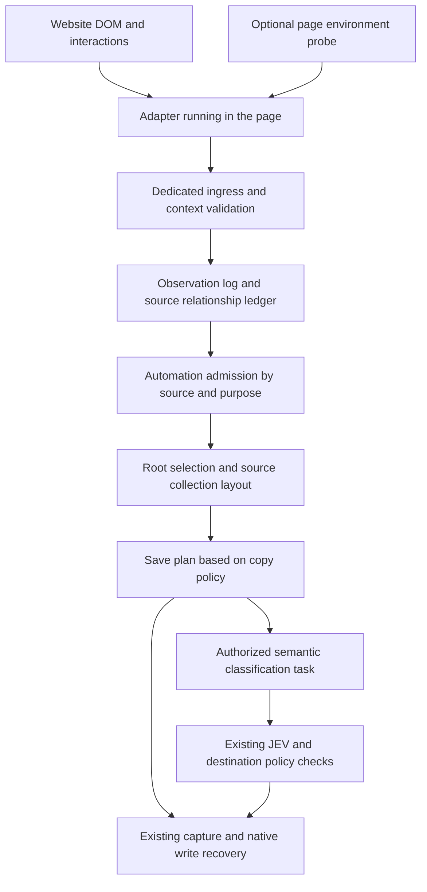

# Website favorites adapter design

Status: proposal, not implemented. Research date: October 18, 2026. Repository baseline: `67ece2543094ae114b1d99abe793437e4d856d89`.

Use website adapters running in the page, a source relationship ledger persisted by the host extension, existing automation evaluation, and a shared save planner. Adapters extract items, collections, and membership changes. The host decides whether to save, how many copies to keep, where they belong, and whether to invoke JEV. Bilibili is the first validation target.

The first phase uses a bundled Bilibili adapter, browser rules, and JEV classification through the local provider. Source archives are written to a local folder explicitly bound by the user. Community scripts use a separate user-script execution environment. Account rules, cloud automatic classification, and cross-device source management follow when their server contracts are available. Synchronizing ordinary bookmarks and synchronizing source facts and management authority are separate capabilities.

Here, archive means native bookmarks and source relationships, not downloaded videos, page snapshots, or offline content. The first distributable release comprises phases A–C below; phase A is a feasibility gate, not a promise that signed-in Bilibili flows already work. Ship the bundled adapter independently of the community-package runtime. Version one keeps native bookmarks when a source membership disappears and does not mirror source deletions or reorder existing bookmarks.

Companion files: [draft contracts](contracts.ts), [typed examples](examples.ts), and [browser capabilities and implementation references](references.md). These interfaces are design artifacts, not current runtime code or a published API.

## Approach selection

| Approach | Fit for this extension | Decision |
| --- | --- | --- |
| One click or MutationObserver rule for every website | Cannot reliably identify the content item, source collection, or successful operation | Provide observation tools in the SDK; keep website semantics in adapters |
| Cloud API polling for every source | Can discover changes while the browser is closed, but requires platform authorization, server credentials, and different API capabilities | Consider for individual sources later; start locally |
| JSON selector configuration only | Fits fixed controls and fields, but struggles with multistep dialogs, SPAs, and business errors | Keep limited declarative UI configuration; use code for complex sites |
| Execute third-party JavaScript directly in the extension background | Simple integration, but grants excessive extension capabilities and crosses MV3 remote-logic boundaries | Reject |
| Forward events through a separately installed userscript manager | Reuses the script ecosystem, but adds dependencies and cross-extension sender identification | Do not use as the default runtime |
| Bundled adapters and USER_SCRIPT community adapters sharing standard facts and host plans | Integrates with local saving, automation, and JEV while separating site logic from bookmark permissions | Adopt; validate the bundled Bilibili adapter first |

## User actions and save outcomes

After an item is saved to source collection B, the source graph records `Video1 → B`. Automation selects `/root/videos/bilibili/` as the mount root, and the layout step resolves `/root/videos/bilibili/B/Video1`. A later semantic save from the popup can use JEV to select `/root/servers/network-configuration/Video1`.

One video is one source item, but can have multiple native bookmark representations. An existing URL alone does not settle the save intent.

| User policy | Source archive first, then semantic save through the popup | Semantic save first, then a source favorite |
| --- | --- | --- |
| Keep both locations | Keep the source copy; create or reuse a semantic copy | Keep the semantic copy; create a source copy |
| Single copy, semantic location preferred | Move an extension-managed copy through the authorized semantic workflow and retain its source association | Update source relationships and reuse the semantic copy without recreating a source copy |
| Single copy, preserve the existing location | Keep the bookmark and show the classification suggestion; let the user explicitly choose whether to move it | Update source relationships and preserve the existing location |

With both locations enabled, an item belonging to B and C may have one copy in each collection and one semantic copy. A single-copy policy must select a primary source collection or preserve the first confirmed location. If an item is initially added to multiple collections without a primary selection, request a location decision rather than choosing by name or message order.

An unassociated bookmark with the same URL is a possible existing item, not a source representation the extension may automatically take over. Offer reuse, save another, or skip; establish the association only after user consent. Automatic policies must respect subsequent manual edits, moves, and deletions.

Before reusing a native ID, compare its bound creation identity with the current node. The existing [bookmark annotation](../../src/bookmark-annotation-store.ts) and [folder description](../../src/folder-description-store.ts) checks compare dateAdded when available but permit missing values. They are useful integration points, not sufficient proof for automatic source management. Persist the device-local binding, node kind, dateAdded when available, and original write receipt or explicit adoption. Missing identity proof or a mismatched node enters detached/review; matching URL/title is insufficient.

## Integration boundaries in the current code

| Existing location | Current behavior | Design requirement |
| --- | --- | --- |
| [Manifest](../../manifest.base.json) | MV3, Chrome 121 minimum; optional site access; no scripting, userScripts, or webNavigation | Request exact site access and optional scripting/webNavigation when enabling the feature; enable user scripts separately |
| [Build](../../scripts/build.mjs), [release verifier](../../scripts/verify-release-artifact.mjs), and [manifest tests](../../tests/manifest-security.test.ts) | ESM entry points; permission arrays are asserted exactly; tests assume no page bridge | Add separate classic-script bundles and update the explicit permission/transport contracts together |
| [Chrome declarations](../../src/chrome.d.ts) | A handwritten subset; MessageSender lacks frameId, origin, and documentLifecycle; new script APIs are absent | Add narrow, version-aware API declarations and browser-backed checks; types do not establish runtime availability |
| [Sender validation](../../src/sw/messages.ts) | Accepts only options, popup, and capture-tabs pages | Preserve the existing boundary; add a dedicated adapter entry and onUserScriptMessage |
| [Capture entry](../../src/sw/capture.ts) | Resolves a fallback folder before rulesDecision; a rule match suppresses folder classification | Plan first, allow a rule to resolve the root independently, and separate sourceArchive from semantic tasks |
| [Rule dispatch](../../src/sw/automation.ts) | Account rules run first; browser rules decide only when no account rule matches | Preserve existing entry ordering; explicitly admit new site entries without expanding old rules |
| [Browser rules](../../src/automation/browser-rules.ts) | Reuses RuleDefinition, binds native destination IDs, and excludes imports by default | Add host admission and layout settings; reuse predicates, arbitration, and the rule UI |
| [Rule evaluation](../../src/automation/runtime-profile.ts) | One input snapshot, multiple matches, shared placement arbitration | Keep it as the deterministic core; do not introduce a plugin-defined rule language |
| [Capture state](../../src/capture/state.ts) | An exact URL match ends as existing unless another copy was requested | Resolve reuse, another copy, or a move by item identity, purpose, and membership before entering this path |
| [Capture store](../../src/capture/store.ts) | Claims commands durably, but coalesces active non-saveAnother tasks by scope/URL; retry comparison covers URL, target, and saveAnother | Planned effects need distinct identities and full command-digest checks; do not alias different purposes or collection copies |
| [Classification triggers](../classification-triggers.md) | Implicit form-open suggestions skip existing bookmarks; explicit requests may classify them | Preserve the default and expose explicit save-as-semantic or classify-this-copy actions |
| [Local taxonomy](../../src/classification-local-taxonomy.ts) | Builds candidates from native folders, excluding subscriptions and unwritable subtrees | Apply a separate AI destination policy; do not treat source mounts as read-only subscriptions |
| [Local classification](../../src/sw/classification-local.ts) | Popup and automatic saves share the local provider | Reuse JEV; check destination policy before dispatch, when reusing cached results, and before moving |
| [Native saving](../../src/save-entry.ts) and [recovery](../../src/sw/capture-native.ts) | Retains write intents and native-ID receipts; does not recreate an unknown result by URL | Reuse this path for each planned effect with a separate command identity |
| [Local import](../../src/local-import/coordinator.ts) | Persists progress and pauses on unknown native outcomes | Reuse its recovery principles; add source identity instead of losing it through an HTML-only conversion |
| [Echo detection](../../src/automation/causation.ts) | Distinguishes owned creates, inbound projections, imports, and new intent | Treat the resulting onCreated as ownEcho, not another favorite or classification trigger |
| [Server receipts](../../../server/src/infrastructure/automation/intake-receipt-store.ts) | Requires the actual parent to equal the fixed bound destination | Do not report dynamic child layouts as successful under the current account receipt contract |

Two verified compatibility constraints determine the release stages:

1. The shared automation profile is `browser-bounded-v1`. Its predicate fields do not include source accounts, source collections, or capture purpose. Introduce source conditions as browser-host admission settings first, without adding unknown fields to v1 Predicate.
2. `src/generated/classification/` is generated by the Know-N backend and must not be edited directly here. Complete destination exclusion for cloud classification and capture APIs requires changes by that owner. Local taxonomy and application checks can be implemented outside the generated code in this repository.

### Required host refactoring

The current CaptureSource union has no site entries, and startCapture derives automatic saving and classification from popup preferences, resolves a fallback folder, and calls rulesDecision again. Passing a plan's final folder to this function would allow another rule to replace it and could trigger tag classification on a source archive. Build an internal `executePlannedSave(planId, effectId)` boundary that loads an approved durable plan, checks its fences, and starts capture/native execution with an explicit purpose and classification disposition. Reuse the coordinator, write intents, annotations, and recovery; do not run admission or placement a second time. A page cannot call this boundary or submit its arguments as authority.

Add site capture metadata through a versioned capture-store migration, including old pending tasks and history display. Ordinary captures retain their behavior. Source-archive effects explicitly disable both folder and tag model requests even when automatic popup saving is enabled. Semantic effects follow existing rule/provider/consent controls. These changes, folder-create recovery, and the destination policy are prerequisites, not existing SDK features.

## Runtime architecture

The adapter has a page DOM context; the background service worker does not. DOM elements, MutationRecord objects, and Response objects remain within page execution. Cross-boundary messages contain bounded JSON facts, not the whole document, complete network traffic, cookies, Authorization headers, CSRF tokens, or model credentials.

A package declares its matching sites, entry point, and requested capabilities. Installation establishes host authorization. The first version bundles each entry into one file, avoiding runtime dependency resolution, npm installation, and remote module loading inside the extension.

### Official and community code

Official adapters ship with the extension and run as ISOLATED content scripts registered for exact site matches. Enabling an adapter also installs it explicitly in already-open authorized pages, with document and installation generations preventing duplicate initialization. Do not observe every website continuously to achieve generality.

Community JavaScript runs through `chrome.userScripts` in USER_SCRIPT worlds, with a separate worldId and messaging capability token per installed version. It does not execute in service workers, options, or popup pages, or through eval, new Function, or dynamic imports in extension pages. Declarative configuration parameterizes a finite set of bundled operations. New user logic follows the user-script path rather than extending configuration into an interpreter for downloaded commands.

Chrome 121 supports bundled adapters. Named USER_SCRIPT worlds require Chrome 133, so community adapters require 133 without raising the minimum for other features. Chrome 138 and later use Allow User Scripts in extension details; versions 133 through 137 use Developer mode. Follow Chrome's manifest userScripts permission and user-toggle mechanism; do not promise that an ordinary permissions.request call completes every step. [Browser evidence](references.md#user-scripts)

Registration applies to future matching document loads. Bundled adapters can use scripting.executeScript to attach to an open document. Community adapters on Chrome 133–134 require a reload; Chrome 135+ can use userScripts.execute in the same named world. Never use scripting.executeScript as a fallback for community code. Late attachment cannot recover an earlier favorite response or recreate document_start interception. Show `reloadRequired` or `observationDegraded` explicitly.

USER_SCRIPT isolates extension internals but is not a complete sandbox for arbitrary third-party behavior. A script can access the authorized site's DOM and may make page-permitted network requests, change the page, or occupy its thread. Explain this at installation. The SDK withholds bookmark and model powers without claiming to prevent every DOM write or data disclosure.

### Permissions and release artifacts

| Feature | Manifest and activation change | Failure behavior |
| --- | --- | --- |
| Bundled observation | Add optional scripting and webNavigation; request them and exact HTTPS page origins from an extension-page enable action | Remain disabled if denied; activeTab only supports an explicitly invoked, temporary session |
| Native archiving | Reuse optional bookmarks and the existing writable-folder picker | Record no write authorization until permission and a root are available |
| Audited background read | Request the recipe's data origin separately from page matches | DOM-only operation or a visible unavailable capability |
| Community execution | Phase D adds userScripts to optional_permissions; request it separately and check the browser toggle/API | Disable this runtime without affecting bundled adapters |

Host permissions ignore paths; registration patterns and host validators enforce the narrower page/recipe scope. Do not request tabs just to address a known tab or enumerate authorized URLs. No new webRequest, declarativeNetRequest, debugger, offscreen, or broad externally_connectable entry is needed for this design. The existing subscription external bridge remains a separate interface. [Permission evidence](references.md#messaging-and-storage)

Build the bundled SDK/adapter and MAIN probe as self-contained classic scripts (for example esbuild IIFE output), with no unresolved ESM imports. Keep the service worker's existing module build. Use scripting injection for the bundled probe; a DOM script tag would introduce page CSP and web-accessible-resource requirements. Preserve the extension-page CSP. Update build assertions, artifact verification, and manifest-security tests to check the exact new surface, retaining rejection of remote code in privileged contexts. Do not merely remove the old negative checks.

### Sender identification and revocation

Existing management ingress continues to accept extension pages only. Bundled scripts use dedicated adapter message types; user scripts use onUserScriptMessage or onUserScriptConnect. Arbitrary external web-page messaging is not part of this interface.

Do not trust an adapter's claimed adapterId, tabId, account, userGesture, or world name. Associate requests using the browser-provided sender, a random capability token privately injected into the execution world at installation, current grants, and installation generation. Chrome's public MessageSender schema currently has no dependable userScriptWorldId field. A worldId provides isolation, not a verified Chrome sender credential. Tokens never pass through the DOM, URLs, or the page MAIN world. [Messaging evidence](references.md#messaging-and-storage)

Bootstrap is separate from an authorized observation. A bundled bootstrap uses the dedicated content-script channel and the host's shipped registry. A community bootstrap includes an installation credential in the registered code, stored only in trusted host storage and the named world. The host checks that credential before replying with a fresh document/route/source lease and transport capability. It never returns credentials in response to an unverified adapterId. A credential identifies an installed script, not the truth of its reports: a malicious authorized adapter can fabricate facts within its grant.

Pin the package digest over the authored bytes separately from the host-generated bootstrap wrapper. Scope credentials to an installation generation and rotate them on replacement. A supported document proves only that the script is running within its site grant; recipe access and source identity still need independent validation.

Persist installation generations and credentials independently of worker globals. On worker wake, reconcile the desired installation records with actual registrations and permissions; on extension update, restore user-script registrations with new credentials/generations. Existing pages must reconnect or reload. Register listeners synchronously at worker startup and await initialization inside handlers. Bootstrap returns a typed unavailable/version/source error instead of silently downgrading the protocol.

Validate sender.id, actual URL/origin, tab/frame/document, enabled state, source session, and installation generation. Version one accepts top-level pages only, excluding incognito, prerendered, and stale documents. Cross-origin frames require separate implementation and grants. Use host webNavigation history updates and page detection to establish a new routeEpoch for SPA navigation. Browser navigation events do not prove business success; page data remains low-trust input.

Treat pagehide, history/fragment changes, account changes, and BFCache restoration as lifecycle boundaries. Abort the old AdapterContext and outstanding interactions before issuing a new context/lease; routeEpoch is a snapshot, not a mutable shared variable. On pageshow after BFCache, revalidate with the host. For ports, sender.documentLifecycle describes connection time, so also check the host's current document state on every command. A disconnected port does not itself revoke already accepted durable work; explicit disable/revocation does. [Navigation evidence](references.md#background-lifecycle)

Revocation first increments installation generation and closes write authorization, then asks the page to remove listeners, observers, timers, and UI, cancels background work, and unregisters scripts and unused host grants. Unregistering cannot remove already-executed code. The background must reject old scripts even if they fail to clean up. Reference-count shared host grants so disabling one feature does not revoke another feature's active access.

Handle permissions.onRemoved and recheck effective grants before effects. Do not assume the user-script toggle has a dedicated change event or that a previously defined API namespace remains usable. Probe userScripts availability when reconnecting and before admitting/dispatching community work; an API rejection closes its authorization. Already issued browser writes follow the late-result recovery rule below.

Current code pins the credential storage.session area to TRUSTED_CONTEXTS. Before enabling page scripts, configure every used chrome.storage area containing private settings or credentials for trusted contexts and verify this during initialization. Access levels apply to whole storage areas, not individual keys. Project only adapter settings through the SDK; keep the private ledger in extension-origin IndexedDB. Failure to establish the required storage boundary blocks adapter activation. Existing session protection does not establish isolation for every storage area.

## Website observation and DOM injection

Adapters expose bounded entry points such as start(ctx), readItem, readCollectionsPage, and readItemsPage; ctx carries the cancellation signal. The SDK provides delegated events, scoped DOM observers, condition waits, navigation notifications, standard control mounting, and emit. Complex sites compose these tools in adapter code rather than forcing every interaction into JSON selectors.

Distinguish three inputs:

| Input | Meaning | Consequence |
| --- | --- | --- |
| Confirmed source favorite operation | The user completed an addition to or removal from a source collection | Update source relationships and plan effects under the enabled local archive policy |
| Existing favorite state observed on a page | Existing state discovered after refresh or another change | Update state without inventing a new user favorite or model request |
| Local capture requested through an injected control | The user asks the extension to save | Enter the local capture flow without claiming the website also saved it |

A native control click establishes intent only. Capture the item ID, source account, routeEpoch, and known prior state when the interaction starts, then wait for the site's business response or confirmed stable state. Optimistic UI, failure messages, cancellation, timeout, and HTTP 200 alone do not establish success. Report uncertain when confirmation is unavailable; do not guess placement or delete anything.

For an injected control, the adapter supplies an anchor, relative position, itemResolver, and action ID. The host SDK creates a control with fixed text/icons and handles idempotent mounting and cleanup. An extension-page confirmation is required to expand permissions or authorize model spending. Even an isTrusted page event does not authorize arbitrary bookmark operations; synthetic events and page overlays must not expand installation grants.

The control opens an extension-owned save entry through a host-issued request ID. The extension reloads and displays the proposed item there; arbitrary native IDs, consent, or automation results from the page are rejected. Use host-localized action labels, keyboard-accessible controls, and textContent for source titles. Scope/debounce observers, cap wait times and pending work, and remove listeners/observers on cancellation. DOM mounting and shadow roots provide presentation isolation, not trusted UI.

### Network observation and reads

Choose capabilities per site: available and authorized official APIs, DOM confirmation, or a narrowly scoped page probe when needed. Chrome webRequest exposes request lifecycle events and some header/body information, but does not provide an arbitrary response-body subscription API. declarativeNetRequest does not extract business responses either. [Network evidence](references.md#network-and-page-capabilities)

MAIN-world probes use audited code bundled with the extension and project only approved fields from exact endpoints and methods. Install fetch/XHR wrappers at document_start where necessary. Preserve the site's request, return, and exception behavior, and do not retain whole responses. Never replay a write request just to confirm a favorite. Previously captured function references, Workers, WebSockets, and frames can bypass the probe, so report unsupported or degraded coverage rather than promising complete observation.

MAIN shares the page environment, so probe events can be forged by the page. Probes provide observation evidence and hold no installation token, extension credential, local folder ID, or model power. A reported success or click from MAIN is not a browser-authenticated business fact.

Cross-origin content-script fetch remains subject to page same-origin/CORS constraints. Background reads require the corresponding host permission and do not automatically solve login cookies, SameSite, partitioning, or third-party cookie policy. Check Bilibili page and data origins separately; the existing cookies permission does not establish access to arbitrary site sessions.

When background reading is needed, expose audited named operations with bounded parameters, such as readCollectionPage(collectionId, cursor). The host recipe fixes the endpoint, method, response type, projection, rate limits, and credential policy. Reject arbitrary URLs, headers, POST bodies, redirects, and unauthorized targets. A new community adapter without a host recipe can use DOM or page-permitted reads; it cannot borrow existing Know-N, AI-provider, or self-hosted-server access.

Each recipe declares a timeout and maximum response bytes enforced while reading, not only after JSON parsing; validate its output schema before projection. Use a small per-connection queue, bounded retries with backoff/Retry-After, and stop on authentication loss, schema changes, or site challenges. Live user observations take priority over import reads. Fetch failures and schema mismatches do not imply an empty collection.

## Source entities and event contracts

Separate the following identities:

| Identity | Purpose |
| --- | --- |
| installationId | The installed adapter code/version and its upgrade or uninstall boundary |
| connectionId | The user-connected website and site account, stable across adapter versions |
| itemId | A stable site ID for a video, article, post, or other item, independent of title and short links |
| collectionId | A stable source collection ID; its name is mutable |
| local nativeId | The actual bookmark or folder on this device; never a binding in a shareable package |

A connectionId must survive adapter upgrades or replacement to avoid copying every favorite again. Allow one active collector installation per connection. Handoff increments collectorGeneration and transfers the ledger. Do not automatically merge different source accounts, device configurations, or private-browsing contexts.

Multiple documents may observe the same connection, but there is only one host ledger writer and planner reservation per item. A siteKey and item/collection ID format are versioned contracts: an adapter update that changes identity normalization needs an explicit alias migration. An unchanged URL is insufficient to infer that migration.

Use URLs to open items and find possible existing bookmarks, not as sole proof of source identity. When no site ID exists, allow an explicitly marked canonical-URL identity with weaker automatic association. Never derive identity from a title. The adapter proposes a canonical URL; the host checks its scheme, allowed source scope, and length. Do not bookmark playback URLs containing credentials or expiring tokens.

Source collections form a tree; items and collections have a many-to-many relationship. parentId: null means a known root, while omission means unknown ancestry. Reject cycles, unresolved layouts, and excessive depth. Sites without collections may use a host-created virtual default collection in a reserved namespace. An unknown collection cannot stand in for a default.

SiteObservation contains standard entities, membership deltas or complete memberships, observation type, and bounded evidence. Complete mode requires knowledge of every collection membership for that item. Observing B does not remove A or C. A removal fact updates relationships without automatically deleting native bookmarks.

Keep adapter input separate from the host envelope. The adapter sends requestId; after validation the host attaches the real sender, connection, entry kind, installation and source-session generations, reception time, and observation order. Retain the interaction's item rather than re-reading it after page changes. A page-extracted site account is a claim to verify, not platform-signed authentication. If identities cannot be distinguished, pause automatic archiving and ask the user to confirm the source in an extension page. Visiting another person's public collection does not identify the logged-in account.

Proposed initial limits: 256 KiB per observation; 512 KiB and at most 100 entities per collection or item page; IDs up to 128 characters, titles 4096, URLs 8192, 64 memberships per item, and collection depth 32. Semantic candidates retain the existing 10000-folder ceiling. These are implementation starting points to validate under load, not browser guarantees.

Measure wire size as UTF-8 JSON bytes and validate closed discriminated objects, finite numbers, unique IDs, disjoint delta sets, cursor length, and bounded nesting. Overflow is a typed error; never truncate a complete membership set and apply it as authoritative. For a missing stable collection ID, keep label-only data as preview evidence and require explicit one-time placement; do not create durable label-derived mappings.

### Acceptance and idempotency

Return accepted only after one IndexedDB transaction persists the observation and pending work. Acceptance means durable receipt, not bookmark creation. Until acknowledged, the adapter resends the same requestId and payload. Reusing that identity with different data returns conflict.

Digest the validated operation and its data, excluding renewable lease/capability fields. Authenticate the current envelope first, then compare with the saved digest. Responses on ports echo requestId so observation acknowledgments, named-read results, and import results cannot be confused. A successful bootstrap or named read is not an observation receipt.

The transport deduplication key includes installation generation, document session, and requestId. It excludes the renewable lease ID so reconnecting within the same document cannot bypass deduplication. The representation key includes connection, item, purpose, source collection, and stable mount ID, not mount revision or title. Transport deduplication prevents replay; representation identity prevents duplicate copies after refresh, import, or repeated observation. A new requestId cannot bypass an existing representation, and global URL deduplication cannot discard a requested second purpose. Changes to a mount root require a migration plan instead of silently generating a new representation key.

Atomically reserve representation effects in the source store before enqueueing native writes. Serialize single-copy decisions by connection/item across all purposes and tabs; uniqueness per purpose alone would still allow a source and semantic copy to race. Repeated classification uses a stable intent/command identity and the existing classification receipts, never the observation requestId alone. Source state observations do not create new archive effects unless a separately authorized import/reconcile plan permits them.

An event without durable acknowledgment may be lost when its page closes. Repair through authorized reconciliation or a later import. Do not promise observation of phone activity while the browser is closed or end-to-end exactly-once execution.

## Batch import and fact merging

An extension page creates importRun and pins the source account, collectorGeneration, adapter version, rules, folder bindings, copy policy, and classification-policy version. The user chooses structure preservation or rule-based organization and reviews local effects. The first version does not invoke AI during bulk import; semantic organization requires a separate authorized task.

The host pulls pages and advances the cursor after acknowledging each page. Allow only one traversal that changes a given collector document at a time. DOM pagination changes the visible page, so show progress and a stop action. Prefer a dedicated import tab, stopping when it closes or the user takes control.

### Import transport and checkpoints

The host cannot call a page-local readItemsPage function directly. After bootstrap, the SDK opens a dedicated runtime port (onConnect for bundled scripts, onUserScriptConnect for community scripts). The host sends bounded read-page commands over that verified port; user-script downlink uses the established port, not an assumed tabs.sendMessage route into USER_SCRIPT. Each command pins readSessionId, pageRequestId, requested collection/cursor, lease, and deadline. The response repeats the identifiers; the host derives the import cause and scope from its own command record.

Permit one outstanding page per traversal. A source-store transaction records the page digest, merge work, next cursor, and receipt before acknowledgment; the next command is issued only after that transaction commits. Lost acknowledgments replay the same page result and request identity. An unsolicited result, changed payload for the same request, expired lease, cursor cycle, or collection mismatch cannot advance the run. Typed read errors distinguish unavailable page, signed-out, rate-limited, unsupported extraction, and malformed data. Port loss pauses DOM traversal, while already acknowledged pages and approved native effects remain durable.

If reaching a requested DOM page changes the route/document, invalidate the old read command as usual; the durable run retains its last acknowledged cursor. After bootstrap on the new page, the host may issue a new pageRequestId for that cursor only after checking the same source and requested collection/page. The adapter checks whether it is already on that page before clicking again. Never accept the old lease's reply merely because navigation was expected. If position cannot be established or the user navigated elsewhere, pause or restart-and-deduplicate instead. This separates import progress from page lifetime without exempting import tabs from navigation validation.

Define SourcePage.coverage as the adapter's coverage claim for the requested page; the host alone decides coverage for the entire run. Enumeration may need several sessions. A pointInTime claim requires a site-issued snapshot token with verified semantics shared by every page, not a locally invented timestamp. Initial Bilibili DOM imports use bestEffort.

A stable API cursor can resume after source and cursor validation. DOM page numbers generally cannot restore a stable snapshot. Declare restartAndDeduplicate, enumerate again from the beginning, and reuse imported items by stable item/collection identity. An in-memory AsyncIterator is not a recovery mechanism.

nextCursor: null ends a traversal. Mark it complete only after all pages are acknowledged, no pages failed, and identity and extraction scope remained stable. It can still be bestEffort rather than a platform-provided pointInTime snapshot. Failures, filtering, insufficient permissions, unstable pagination, or visible-only coverage remain partial. Complete traversal does not authorize deletion by default.

Record the ledger baseline ordinal when import starts. Later live events form an overlay; old import pages cannot overwrite removals or collection changes that occurred during import. Use comparable site versions when available. Reception order alone does not establish source causality. Preserve newer interaction results on conflict, schedule reconciliation, and pause the affected projection when needed.

For each item/collection edge, retain the last applied host ordinal and evidence kind. A best-effort import may add an observed edge only if no accepted live mutation touched it after that run's baseline; it never infers absence from a missing row. Apply the same baseline protection to collection names/ancestry. For conflicting live reports from different documents or overlapping interactions without comparable source revisions, retain both observations and mark the edge unresolved until an authorized read settles it. Host timestamps and adapter sequence numbers cannot order independent site operations. A complete-membership report carries the same conflict checks for every changed edge.

Live observation and import share the item/membership ledger while preserving distinct siteFavorite, siteImport, and reconcile causes. Importing existing content does not manufacture a fresh user click or another semantic classification task.

## Reusing automation

Phase one adds BrowserSiteRuleExtension as browser-host configuration associated with the existing BrowserRule record:

- admission selects entries, purpose, connection, and optionally source collections.
- definition retains RuleDefinition, finite predicates, URL normalization, and priority.
- layout maps source collections into real folders below the selected root.

Admission matches authorized host facts through fixed settings, without another expression language. Rules remain editable, previewable, pausable, and inspectable for conflicts in automation. Website settings reference ruleId instead of copying classification logic. Shareable packages contain no native folder bindings and cannot enable rules on installation.

Upgrade local rule storage to v2 and validate admission/layout explicitly. The current v1 parseRule retains some unknown fields while its executor does not understand source restrictions. Writing source rules into the v1 key would let old versions execute them as ordinary URL rules. Migrate legacy rules with admission limited to original entries; write new source rules only to v2 storage so rollback versions cannot see them. Backups and imports preserve format and required capabilities rather than dropping fields and enabling a rule with different meaning.

The source toggle controls observation admission. Global automation and individual-rule pauses share dispatch state, prevent new effects, and retain pending work. Recheck pause, authorization, and pinned versions before every effect; page confirmation does not bypass host pause state.

New site entries do not run legacy rules without explicit admission. Existing popup, shortcut, and menu entries retain explicit-folder → account-rule → browser-rule → automatic-classification ordering. Mount rules default to sourceArchive and cannot intercept a popup semantic save solely because the URL is on bilibili.com.

Local sourceArchive evaluation preserves the actual source category. Imports retain import facts and require policy.imports: include plus a confirmed import plan. Reuse pure predicates and placement arbitration with host-authorized rulePlacement intent. Do not call the legacy server bookmark.intake path or relabel import as sync to evade exclusions. The approved host plan supplies rulePlacement; the adapter cannot.

Layout deterministically maps source collections below the chosen root. It is separate from AI classify.refine and root classification. Missing or unwritable roots, unknown ancestry, and conflicting rules wait for repair instead of falling back to an unclassified video bucket.

Map folders by `(mountId, collectionId)`, using titles only for display. Same-name collections get distinct bindings; adopt an existing same-name folder only after user choice. Store the last host-written title/parent and a manual-edit revision. Source renames may update an owned folder only while these still match; local renames or moves retain user ownership. Version one treats changed source ancestry or a changed mount root as a previewed migration, and retains empty folders. Source membership removal retains the native copy as historical archive; in single-copy mode, an existing historical copy also counts until the user authorizes relocation or removal.

A configured mount root is a setting, not an explicit folder selection for each save. A real per-save folder selection still wins. Rules must be able to select a mount root without an ordinary default folder, requiring separation of the current startCapture fallback-folder prerequisite from rule evaluation.

### Dynamic folders and account rules

The current server receipt requires the actual parent to equal the intake-bound folder exactly. An effect whose root is bilibili and final parent is B cannot use that root-placement receipt, or record root success and silently move afterward.

Phase one therefore keeps source layout in browser rules. The current Add to your account action must not convert it to an inequivalent ordinary rule. Account support requires all of the following:

1. A negotiated runtime profile and source-fact contract; browser-bounded-v1 consumers explicitly reject unsupported layout.
2. Source admission with identity, authorization, generations, and idempotency. Facts remain user-authorized device reports, not claims of platform signatures.
3. Canonical root and final destination identities, validated ancestry, mapping revision, and permitted layout. Receipt digests cover final effects.
4. Consistent import cause, origin, placement disposition, and admission across Sync and the server, preventing duplicate admission or unauthorized workers across devices.
5. Native browser IDs and site cookies remain on-device. Source management authority, bindings, and overrides have separate cross-device semantics.

Ordinary bookmarks can follow the existing sync range, but another device does not thereby acquire collection or reconstruction authority for their source. Validate full phase-one behavior under an explicitly local-only root. Verify account background tasks separately for synced roots rather than promising no cloud side effects.

## Integration with JEV classification

Distinguish entry from purpose instead of overloading the existing source field:

| Entry and purpose | Rule and classification behavior |
| --- | --- |
| siteFavorite + sourceArchive | Deterministic mount rule and source layout; no model by default |
| siteImport + sourceArchive | Approved import plan; no model by default |
| popup + semantic | Existing explicit-folder and ordinary automation precedence; JEV when no rule owns the folder |
| injectedControl + semantic | Present an extension save/classification entry; page messages cannot authorize spending |
| reconcile + sourceArchive | Repair state and approved projections without creating semantic save intent |

The two purposes produce separate tasks. Do not copy a sourceArchive automation outcome into semantic CaptureTask.automation: the existing tagsOnly logic would suppress JEV again. Ordinary rules that actually own semantic placement retain their precedence; a model does not override their deterministic decision.

Single-copy semantic preference requires an explicit classification/move of an existing associated representation. Do not pretend a bookmark was newly created to pass saved-capture eligibility. Reuse explicit requests and editing, adding source-binding transfer and detached/tombstone maintenance. Keeping both locations creates an independent semantic capture. Implicit form-open suggestions may still skip an existing URL, while the popup exposes a visible Save another and classify action.

When the user has configured both locations and automatic popup saving, the real toolbar invocation can directly create semantic save intent. After confirming that only a sourceArchive representation exists, the planner authorizes another copy and uses JEV after the new capture is saved, without requiring another bookmark click. Reuse an existing semantic representation or follow the existing reclassification flow. Manual forms still distinguish implicit suggestions from explicit save-another/reclassification requests; do not globally remove existing-bookmark protection.

### AI eligibility of mounted folders

Each mount has aiDestination: excluded | allowed, defaulting to excluded. This restricts AI recommendation and application while allowing deterministic source layout and explicit user selection. Apply it by folder identity and live ancestry, including future descendants.

A mount remains a writable personal folder. Adding it to subscription exclusions would also break personal writes, existence queries, and sync behavior. Introduce a separate classification destination policy shared by these boundaries:

1. Prune excluded subtrees and their examples before candidate generation, not just after model output.
2. Apply the same policy to manual suggestions, automatic saves, and explicit reclassification.
3. Include its effective digest in cache identity. Folder moves/deletions, binding changes, and toggles invalidate prior results.
4. Recheck policy, real ancestry, write permission, and manual-edit fences before dispatch and application.

In local mode, merge excluded roots before nativeClassificationFolders and check suggestedFolder, automatic moves, and editor application. Existing rejectedFolderIds filtering already excludes a folder and descendants, but is not a durable permission boundary: unknown IDs are ignored, so unmappable policy cannot count as enforcement.

Prune only the mounted subtree, not an otherwise allowed ancestor such as videos. Preserve provider selection, budgets, pause, and execution controls. When JEV is unavailable or returns later, a completed source archive remains successful and the semantic task separately reports its unfinished state.

Local classification means browser-managed orchestration with the configured provider; it does not promise an offline model or that bookmark text never leaves the device. Respect the existing local-provider build flag, disclosure, API credentials, and host grants. Source archiving remains usable when that provider is disabled or unreachable.

Cloud popup preview already accepts rejectedFolderIds and can receive canonical identities when mapping is complete. The cloud saved-capture document lacks equivalent destination policy. Local UI filtering cannot constrain a server choice already committed. Complete cloud support must pin a destinationPolicy digest per command, validate it during candidate generation and apply, and cover every classification entry. If support or mapping is incomplete, block the constrained automatic cloud classification with a clear reason; do not silently switch providers or send incomplete exclusion lists.

Reuse the existing generated JEV algorithm, prompts, and thresholds. Changes to generated files must be produced by the Know-N owner and pass its drift checks.

## Persistence and execution recovery

Use a separate site-adapters IndexedDB for source facts and plans. Existing capture, native-intent, and Sync stores retain their ownership. Connect databases through a durable outbox and stable commandId rather than claiming atomic transactions across them.

| Record | Main contents |
| --- | --- |
| installations | Package digest, version, runtime, enabled state, grants, and installation generation |
| connections | Site-account scope, active collector, collectorGeneration, and state |
| observations | Request identity, digest, host context, acceptance ordinal, and processing state |
| documentLeases / readRequests | Verified context, expiry, source generation, outstanding page commands, and replay receipts |
| collections / items / memberships | Source entities/relationships, versions, and observation coverage |
| mounts / folderMappings | ruleId, root binding, collection mapping, naming ownership, and AI policy |
| representations | Item, purpose, source collection, native/canonical identity, and active/detached/suppressed state |
| importRuns / importPages | Scope, cursor, coverage, acknowledged progress, and failures |
| savePlans / effects / outbox | Pinned rule/policy versions, effects, commands, receipts, and retries |
| overrides | Manual moves/deletions, suppression of reconstruction, and primary-collection choices |

After observation acceptance, plans start prepared. Effects advance through reserved → submitted → confirmed. A missing native acknowledgment enters unknown and waits for existing intent receipts; a same-URL search cannot establish success. Plans may be partial, blocked, completed, or cancelled. Retain confirmed effects and handle failed siblings separately.

Persist the outbox command ID and payload digest before dispatch. The capture executor must return the same durable command receipt on retry, or a conflict for different content; otherwise a crash between the two databases could duplicate a write. Recover submitted/unknown effects before considering replacement plans. A policy or source-session change invalidates unsent effects but cannot undo an already issued browser API call. Revoke further work immediately, then record any late native result for review. Do not delete a possibly user-edited bookmark as compensation.

The capture store's current URL-based active-task coalescing must not merge planned effects. Let the planner authorize each distinct create and bypass that coalescing through an internal planned-effect identity or the existing saveAnother mechanism after reservation; retain ordinary popup deduplication. Strengthen command comparison to include purpose, representation, authorization, and classification disposition. Keep a retry receipt until the source outbox acknowledges it, even if normal capture history is pruned.

Folder creation also needs write-ahead intent and native-ID binding. A same-name getChildren result does not prove ownership. Reuse personal-folder permission checks and batch-writing mechanisms, but do not assume bookmark-create receipts already cover new folder workflows. Name ambiguity, unknown outcomes, or user intervention require review.

During preview, reference uncreated folders by planned effect ID, never fabricated native IDs. Effects form an acyclic dependency graph. Bind a parent's proven native ID into successor bookmark commands only after its receipt exists. Changed inputs require a new preview instead of silently altering prepared native writes.

An effect's digest covers its immutable logical input, including planned-parent references. After dependencies resolve, persist a separate resolved command payload/digest in the outbox before first dispatch and never rebuild it differently on retry.

Pre-register a recovery alarm before durable admission, following startCapture, and inspect pending work on startup and relevant events. Drain bounded batches and checkpoint between effects. An alarm or port is a wake-up aid, not a persistent process. Preserve backpressure and errors in storage; suspended/offline documents require a resumed collector session, not a service-worker DOM substitute.

If the user moves a source copy outside its mount or renames it, preserve the change and detach the relevant automatic management while retaining source membership. Deleting a representation records suppressed, preventing reimport from recreating it. Restore only through a new explicit save authorization or user-cleared suppression. Copy-policy changes do not retroactively delete representations; present a migration preview for the user to apply.

Do not evict unfinished or unknown effects to satisfy history limits. Completed observations can be pruned, but retain stable entities, representation associations, necessary command identities, and suppression to prevent duplication after cleanup. Pause admission/import with a visible reason at capacity. Backups add versioned source settings and ledger sections while excluding execution tokens, site sessions, and model credentials. Disconnect keeps native bookmarks by default and lets the user choose whether to clear local source records.

Schema upgrades run before ingestion and preserve unknown effects. A newer unsupported database/package version opens a read-only repair/export path, not a partially interpreted runtime. Restoring a backup creates disabled connections and requires account/root rebinding; foreign device IDs and native bookmark IDs are not portable. Do not restore outbox commands as executable work. Same-device recovery must still prove native identity; suppression may be restored only into the matching source scope. Local-only here means outside this project's COLP sync range; browser-managed bookmark sync is a separate mechanism and does not transfer the source ledger.

Creates, moves, and annotations continue through capture/native paths and coordinator lanes. Their onCreated events do not plan another archive. Do not wait inside a local-write lane for another task that needs that lane: persist and queue work first to avoid coordinator deadlock.

## User interface and development workflow

Website settings include adapter version, source account, grants, live-archive toggle, import, copy policy, primary collection, mount root, and AI eligibility. Reuse automation's folder-binding UI and the same rule record for root editing. Show actual states such as Recorded, waiting to save; Archived; Choose a folder; or Source identity changed.

Develop against local adapter files and sanitized DOM/JSON fixtures, with protocol validation and preview. Pin package versions and digests. Updates disclose changed capabilities, domains, and rule meaning; expanded authorization takes effect only after user selection. Package enabled/trust fields cannot grant consent.

An adapter inspector can display the detected item, source collections, and proposed facts in a dry run without bookmark writes. Exclude cookies, tokens, page bodies, and model keys. Keep private parameters locally and strip account/folder bindings from exported packages.

Track capabilities separately: live confirmation, collection enumeration, and item enumeration may fail independently. Report adapter/runtime version, last confirmed observation, coverage, queue size, and a bounded error code. Repeated extraction/schema failures pause the affected capability without marking the source empty. Keep selectors and endpoint projections within the site module and associate fixtures with the observed site variant/date. Adapter code updates with no new grants still revalidate protocol/identity compatibility; added domains, probes, or recipes wait for explicit authorization. Retain the previous digest for rollback, but rollback never reduces generations or reverses ledger migrations.

## Bilibili validation points

Validate both video-page and list-page interactions, not just one toolbar favorite icon. The aggregate saved state may stay true while membership changes between B and C, so confirmation must identify individual collection changes.

Bilibili Evolved's quick-favorite implementation identifies a video by aid and membership by numeric collection id, title, and fav_state. Its write request names added/removed collections, and it reports success only when the business response code is 0. This supports investigating stable identities and business confirmation, but does not establish the current native page's request path or authorize this extension to use the endpoint. [Implementation evidence](references.md#existing-implementations)

Probe the bundled adapter in this order:

1. Capture the video ID, source session, and interaction ID before opening the dialog. On list pages, resolve the clicked card rather than the list URL.
2. Resolve collection names and IDs from the dialog or a previously read catalog. Mark name-only identity as weak instead of inventing a strong mapping.
3. After submission, confirm final membership for the corresponding video and collections. If a network probe is needed, project only item identity, added/removed collection IDs, and business outcome; discard CSRF, cookies, and unrelated fields.
4. Emit confirmed changes as delta. Do not send complete unless all collections are known to be loaded.
5. End the interaction on cancellation, failure, account change, or navigation change. Unconfirmed input produces no save plan.
6. First validate DOM traversal for A/B/C import. Add a named host read recipe only if an evaluated, usable endpoint exists. Report missing capability rather than falling back to broad, hidden collection.

Produce sanitized fixtures for adding to B, adding to B/C together, moving membership from B to C, existing multiple memberships, cancellation, business failure, slow responses, and SPA navigation. Protocol and planner tests should use these shapes instead of an idealized successful click alone.

## Module responsibilities

These are proposed module boundaries, not existing implementations:

| Module | Responsibility | Existing integration |
| --- | --- | --- |
| src/site-adapters/runtime/ | Package registry, page lifecycle, user-script execution, and dedicated transport | Thin service-worker dispatch |
| src/site-adapters/sources/ | Connections, source entities/relationships, import pagination, and merging | Separate source IndexedDB; no ownership of Sync storage |
| src/site-adapters/planning/ | Admission, source layout, copy policy, plans, and outbox | Existing evaluator and capture/native execution |
| src/site-adapters/adapters/bilibili/ | Site detection, confirmation, extraction, and DOM import | No direct chrome.bookmarks or provider credentials |
| src/classification-destination-policy.ts | Identity-based exclusion and application checks | Local taxonomy, preview cache, capture classification, and editor application |
| Browser rule extensions in src/automation/ | Entry admission, layout, v2 storage, preview, and pause | Shared evaluator and unchanged ordering for ordinary entries |
| Plan integration in src/capture/ | Valid tasks for sourceArchive and semantic purposes | Existing receipts, annotations, history, and manual-edit protection |

Plan execution is an internal host API. Web pages cannot submit approved automation decisions or native IDs. Generate production SDK runtime schemas, host validators, and adapter development types from one contract so TypeScript types are backed by message validation.

## Implementation sequence and acceptance

| Phase | Deliverable | Acceptance |
| --- | --- | --- |
| A Browser and site probes | Controlled pages, bundled script, dedicated ingress, sanitized real-site observations | Video/list dialogs, success/failure evidence, stable collection IDs, and SPA navigation |
| B Local sources and mounting | Source ledger, BrowserRule admission, mappings, and write-ahead plans | A/B/C import, live B archive, repeated import, unknown outcomes, and manual moves |
| C JEV and copy policies | Purpose separation, AI subtree exclusion, and explicit existing-copy classification | Both action orders follow policy; mount rules do not swallow semantic popup requests |
| D Community packages | USER_SCRIPT isolation, capability tokens, installation, and revocation | Reject forged/stale ingress and MAIN impersonation; deny writes from surviving old scripts; verify cleanup and update re-registration |
| E Account and cloud contracts | Profile negotiation, source admission, final-placement receipts, and cloud destination policy | Server-verified final effects, no duplicate admission across devices, explicit rejection by older clients |

Real Bilibili selectors, collection-ID visibility, and confirmation signals still require validation in an authorized signed-in account. Public script selectors are not a guarantee of current site behavior. If only names are visible, mark identity weak and restrict automatic renaming and ongoing archiving instead of substituting names for stable IDs.

Required acceptance matrix:

1. Video1 added to B lands under B below the rule root; root selection works without an ordinary default folder.
2. Video1 in B and C produces one copy per collection with both locations enabled; single-copy mode follows primary selection or review.
3. Source archive then popup semantic save, and the reverse, satisfy all three copy policies.
4. Repeated messages, refresh, live-then-import, and import-then-live do not create accidental copies or another model call.
5. Failure, cancellation, optimistic UI, HTTP 200 business errors, and timeout do not count as confirmed success.
6. Renames preserve identity; same-name collections stay distinct; deletion, moves, and manual edits are not silently overwritten.
7. Observing B alone, partial imports, and late old pages do not incorrectly remove or restore A/C memberships.
8. Account switches, SPA navigation, collector handoff, and permission revocation invalidate stale work.
9. Synthetic DOM events, MAIN messages, claimed popup/spending authorization, and arbitrary background URLs cannot expand powers.
10. Excluded mount subtrees and future descendants never become AI candidates; cached or in-flight forbidden destinations cannot be applied.
11. Explicit manual selection of a mounted folder works; personal folders remain writable while subscription, managed, and unsupported destinations stay protected.
12. Worker termination after accepting an observation, creating a folder, creating a bookmark, or starting classification recovers or exposes unknown without blind replay.
13. Signed-out, offline, and unavailable-provider states report source archive and semantic failure independently without losing saved content.
14. Global pause, rule pause, and source revocation take effect independently and preserve existing bookmarks.
15. Without new server capabilities, no fabricated receipt is sent and older profiles do not silently ignore layout.
16. Chrome 133–134 reports reload required for already-open community pages; 135+ immediate execution, update re-registration, toggle revocation, and BFCache reconnection preserve the same boundaries.
17. Two tabs and simultaneous source/semantic intents reserve the correct number of copies; contradictory reports remain unresolved, and a lost page acknowledgment does not advance import twice.
18. Source removals retain archive copies; same-name folder creation, identity changes across adapter upgrades, missing dateAdded, and cross-device backup restore require the documented proof or review.
19. Source archive effects make zero model calls, including tag requests, with automatic popup saving enabled. No legacy rule reselects the approved final parent.

Use unit tests for fact merging, planning policies, and permission boundaries, plus focused Chromium integration tests for worlds, sender identity, revocation, DOM lifecycle, and worker recovery. All Playwright runs must use xvfb, and temporary services must stop afterward. Real Bilibili smoke validation uses an authorized account and a small set of reversible actions rather than bulk collection.

Document and typed-example validation is not browser, live-site, or cloud-provider acceptance. Complete phase A before freezing the first distributable SDK.

The current extension tsconfig excludes this docs directory. Validate these drafts explicitly from packages/extension with `node_modules/.bin/tsc --noEmit --strict --skipLibCheck --target ES2023 --module NodeNext --moduleResolution NodeNext --lib ES2023,DOM docs/site-adapters/contracts.ts docs/site-adapters/examples.ts`. When implementing, replace the handwritten draft with generated runtime validators/types and make its focused contract checks part of the package scripts.
